# Product Requirements Document (PRD)
## AI-Powered Website Link Analysis API (`ai-link-analysis`)

> **Author:** Piyush Makhija (Technical Lead / Senior Software Engineer)  
> **Client / Evaluator:** Dxora Technologies (`hr@chivoxai.com`)  
> **Product Stage:** Production-Ready Enterprise Microservice  
> **Version:** 1.0.0-PROD  
> **Date:** November 2026  
> **Status:** Baselined & Enforced  

---

## 1. Problem Definition & Market Opportunity

### 1.1 The Core Business Problem
In enterprise business development, digital marketing strategy, competitive intelligence, and automated sales prospecting, evaluating an unfamiliar web property manually is an enormous operational bottleneck:
- **Time Inefficiency:** A seasoned digital strategist requires between 30 and 90 minutes to manually audit a single website (reading hero copy, inspecting offerings, researching competitors, formulating search queries across channels, and reviewing SEO metadata).
- **Inconsistent Quality:** Manual audits suffer from high subjectivity, missed competitive threats, and incomplete platform coverage (e.g. evaluating Google search queries while ignoring LinkedIn or Instagram discovery terms).
- **Prohibitive Cost at Scale:** Processing a portfolio of 500 prospect websites manually requires hundreds of analyst hours, costing thousands of dollars.
- **Security Vulnerabilities in Naive Automation:** Standard scraping scripts built without strict SSRF protections expose internal cloud infrastructure (such as AWS/GCP metadata services at `169.254.169.254` or internal microservices on private subnets) to catastrophic exploitation.

### 1.2 The AI-Native Solution
The **AI-Powered Website Link Analysis API** (`ai-link-analysis`) completely automates this evaluation pipeline in under **2.0 seconds** for less than **10 paise INR ($0.00105 USD)** per request.

By supplying a single target website URL (e.g. `POST /link-analysis {"url": "https://example.com"}`), client applications instantly receive an authoritative, 5-dimensional strategic business intelligence dossier synthesized by **Google Gemini 1.5 Flash**:
1. **Competitor vs Brand Details:** Core positioning, category, $\ge 3$ competitors, relative strengths, market opportunities, and defensible advantages.
2. **Top 5 Target Search Queries:** Channel-specific queries across Google, Facebook, Instagram, LinkedIn, and X with search intent and audience (**Strict Zero Hallucination Constraint on Search Volumes**).
3. **SEO Improvement Strategy:** Primary/secondary/long-tail keyword targets, high-CTR SEO title structure, 160-char meta description, and supporting landing page content roadmap.
4. **Top 5 Services / Capabilities:** Detailed service breakdown, target industries, buyer personas, and primary business benefits (with explicit labeling for inferred offerings).
5. **Target Audience Identification:** Primary/secondary audience profiles, industry verticals, geographic focus, and core customer pain points.

---

## 2. Target Personas & Detailed User Journeys

### 2.1 Target Personas Matrix

| Persona ID | Role Title | Primary Objectives | Critical Pain Points | Key Value Realization |
|:---|:---|:---|:---|:---|
| **P-01** | **Digital Marketing Strategist** | Build go-to-market and positioning briefs for new clients. | Spends hours researching competitors and audience pain points manually. | Instant 3+ competitor benchmarking and market opportunity identification in <2s. |
| **P-02** | **SEO Consultant & Growth Lead** | Perform technical and on-page SEO audits on target domains. | High effort required to draft title/meta tags and extract high-intent keyword clusters. | Ready-to-deploy SEO titles, 160-char meta descriptions, and 5-platform search queries. |
| **P-03** | **B2B Account Executive / SDR** | Prospect outreach and discovery call preparation. | Lack of quick context on prospect services, target customers, and core pain points. | Itemized 5 services, buyer persona alignment, and pain points delivered directly to CRM. |
| **P-04** | **Platform Architect / API Integrator** | Batch evaluate 10,000+ domain links via automated workflows. | Fragile scrapers crashing on memory bombs, SSRF risks, and spiraling LLM token bills. | Deterministic latency, 100% SSRF immunity, and ultra-low cost ($10.50 per 10k queries). |

### 2.2 End-to-End User Journeys

#### Journey 1: Standard Real-Time Analysis (Happy Path)

```mermaid
sequenceDiagram
    autonumber
    actor Strategist as Digital Strategist
    participant API as /link-analysis Endpoint
    participant Security as SSRF Pipeline
    participant Extractor as HTTPX Extractor
    participant LLM as Gemini 1.5 Flash
    participant Cache as SHA-256 Cache

    Strategist->>API: POST /link-analysis {"url": "https://dxora.com"}
    API->>Cache: Lookup SHA-256(url)
    Cache-->>API: Cache Miss
    API->>Security: Validate Scheme, DNS & IP Subnet
    Security-->>API: Verified Public IP (104.21.48.12)
    API->>Extractor: Stream GET https://dxora.com (10s SLA)
    Extractor-->>API: 200 OK (Clean Text <8k tokens)
    API->>LLM: Dispatch Single-Pass 5-in-1 Prompt
    LLM-->>API: Structured LinkAnalysisPayload JSON
    API->>Cache: Store in Cache (TTL 24h)
    API-->>Strategist: HTTP 200 OK (Complete 5-Dimension Dossier + Telemetry)
```

#### Journey 2: Repeat URL Analysis (Sub-Millisecond Zero-Cost Cache Hit)
1. **User Action:** Sales SDR submits an analysis request for a domain analyzed earlier that day by another team member.
2. **System Processing:** Ingress router computes `SHA-256(canonicalized_url)` and performs an O(1) in-memory cache lookup.
3. **Outcome:** Cache returns valid pre-computed payload in **2ms** with `cached: true` and **$0.0000 API expenditure**.

#### Journey 3: Adversarial SSRF Attack Attempt (Hard Security Interception)
1. **Attacker Action:** An attacker submits `{"url": "http://169.254.169.254/latest/meta-data/"}` attempting to steal cloud instance IAM credentials.
2. **System Processing:** Pre-flight DNS and IP validation detects that `169.254.169.254` falls inside `169.254.0.0/16` (Link-Local / Cloud Metadata blacklist).
3. **Outcome:** Request is immediately terminated before opening a TCP connection. An RFC 7807 problem details envelope is returned (`HTTP 400 Bad Request`, `ERR_SSRF_BLOCKED`).

#### Journey 4: Upstream LLM Quota Exhaustion (Graceful Circuit Breaker Fallback)
1. **Scenario:** High concurrent traffic causes Google Gemini API to return `HTTP 429 Rate Limit Exceeded`.
2. **System Processing:** Circuit breaker trips instantly, shifting execution to **OpenAI GPT-4o-mini**. If OpenAI is unavailable or keys are omitted, the system falls back to **OfflineMockClient**.
3. **Outcome:** Client receives complete, syntactically valid business intelligence without a 500 error or event loop crash.

---

## 3. Product Scope & Functional Feature Matrix

| Feature ID | Feature Name | Description | Priority | Compliance Reference |
|:---|:---|:---|:---:|:---|
| **FEAT-01** | Single Ingress REST Endpoint | `POST http://localhost:4000/link-analysis` accepting JSON `{"url": "..."}`. | P0 (Mandatory) | Dxora Section 2 |
| **FEAT-02** | Zero-Trust SSRF Defense | Pre-flight DNS, loopback/private/metadata IP blacklisting, ports 80/443 restriction. | P0 (Mandatory) | Dxora Section 2 & 9 |
| **FEAT-03** | Streaming Payload Ceiling (5MB) | Aborts streaming download if body exceeds 5MB to prevent memory exhaustion bombs. | P0 (Mandatory) | Dxora Section 5 |
| **FEAT-04** | Semantic DOM Pruning | Strips ``).
- **Engine Handling:** When the DOM pruner discovers that body text contains fewer than 100 characters after script stripping, it inspects `<head>` tags: `<title>`, `<meta name="description">`, OpenGraph tags (`og:title`, `og:description`), Twitter card metadata, and `<script type="application/ld+json">`.
- **Graceful Degradation:** If semantic metadata exists, the LLM performs inference based on the high-signal meta tags. If the page is truly 100% blank, the API returns a clean RFC 7807 error: `HTTP 422 Unprocessable Entity (ERR_EMPTY_WEBSITE_CONTENT)`.

### 4.2 Bot-Blocked Websites & Cloudflare Challenges
- **Problem:** Target websites protected by Cloudflare, Akamai, or AWS WAF may return HTTP 403 Forbidden or HTTP 503 with a JavaScript challenge.
- **Engine Handling:** The HTTPX client includes standard browser headers (`User-Agent`, `Accept`, `Accept-Language`, `Sec-Ch-Ua`). If a 403 or 503 is returned, the engine captures the upstream status code cleanly and returns an RFC 7807 `HTTP 502 Bad Gateway (ERR_WEBSITE_UNREACHABLE)` detailing that the target domain blocked automated access, preventing unhandled server crashes.

### 4.3 Character Encoding & Non-English Web Content
- **Problem:** Websites encoded in ISO-8859-1, Windows-1252, or Japanese Shift-JIS often cause decoding crashes in standard UTF-8 scrapers.
- **Engine Handling:** HTTPX automatically inspects the `Content-Type` header charset and falls back to `charset-normalizer` / `cchardet` auto-detection before passing strings to BeautifulSoup. Multilingual content is preserved; Gemini 1.5 Flash natively processes 100+ languages and outputs structured English analysis.

### 4.4 Redirect Loops & Cross-Protocol Redirects
- **Problem:** Websites redirecting in an infinite loop (`A -> B -> A`) or redirecting from a safe public domain to an internal IP (`example.com -> 127.0.0.1` or `http://169.254.169.254`).
- **Engine Handling:** The engine sets `max_redirects=3`. At every intermediate redirect hop, the target URL is intercepted and passed through the complete 7-stage SSRF validator. If a redirect targets a private IP, it is blocked immediately.

### 4.5 Internationalized Domain Names (IDN) & Punycode
- **Problem:** Domains using non-ASCII characters (e.g. `https://münchen.de` or `https://xn--mnchen-3ya.de`).
- **Engine Handling:** The ingress router applies `idna.encode()` to normalize all hostnames to standard Punycode before DNS pre-flight inspection.

---

## 5. Product Metrics & KPIs (HEART Framework)

| Category | Metric Name | Target SLA / Baseline | Measurement Method |
|:---|:---|:---|:---|
| **Happiness (Quality)** | Grounding Accuracy | 100% of claims grounded in website text or tagged `is_inferred: true`. | Evaluation prompt assertions & audit checks. |
| **Happiness (Security)** | Zero-Hallucination Rate | 0.0% fabricated search volume numbers across all 5 platforms. | Schema validator constraint tests. |
| **Task Success** | End-to-End Latency | Median $\le 1.8\text{s}$, 95th Percentile $\le 3.5\text{s}$. | Correlation telemetry (`latency_seconds`). |
| **Efficiency (Cost)** | Per-Analysis Cost | $\le \$0.00150\text{ USD (~₹0.13 INR)}$ per uncached run. | Telemetry cost tracking (`estimated_cost_usd`). |
| **Reliability** | Availability & Uptime | $\ge 99.9\%$ service availability; 0 unhandled 500 server crashes. | SRE health probe monitoring (`/health`). |
| **Code Health** | Test Coverage | $\ge 90.0\%$ statement coverage on pytest triad test suite. | Automated CI coverage gate (`pytest --cov`). |

---
*End of Product Requirements Document. Authored by Piyush Makhija for Dxora Technologies Evaluation.*
