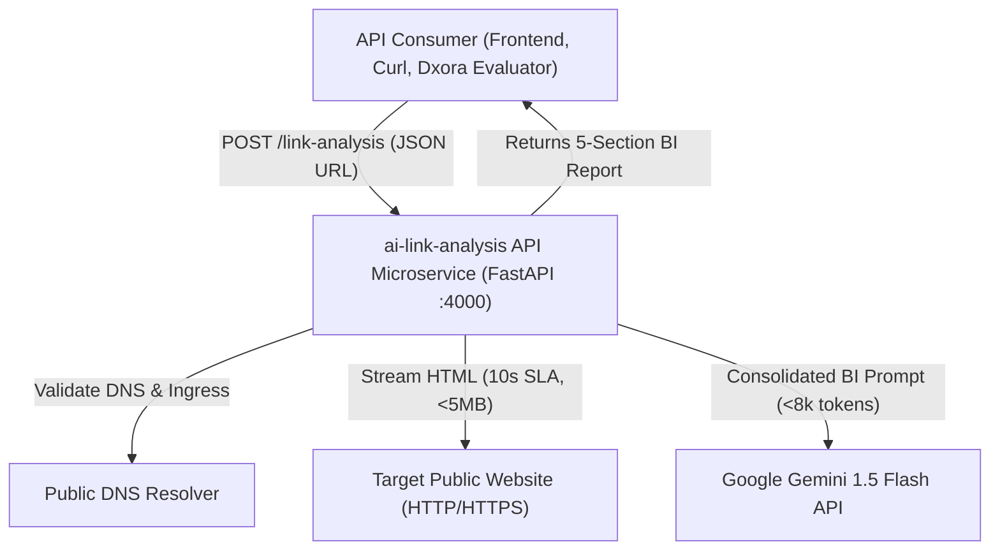
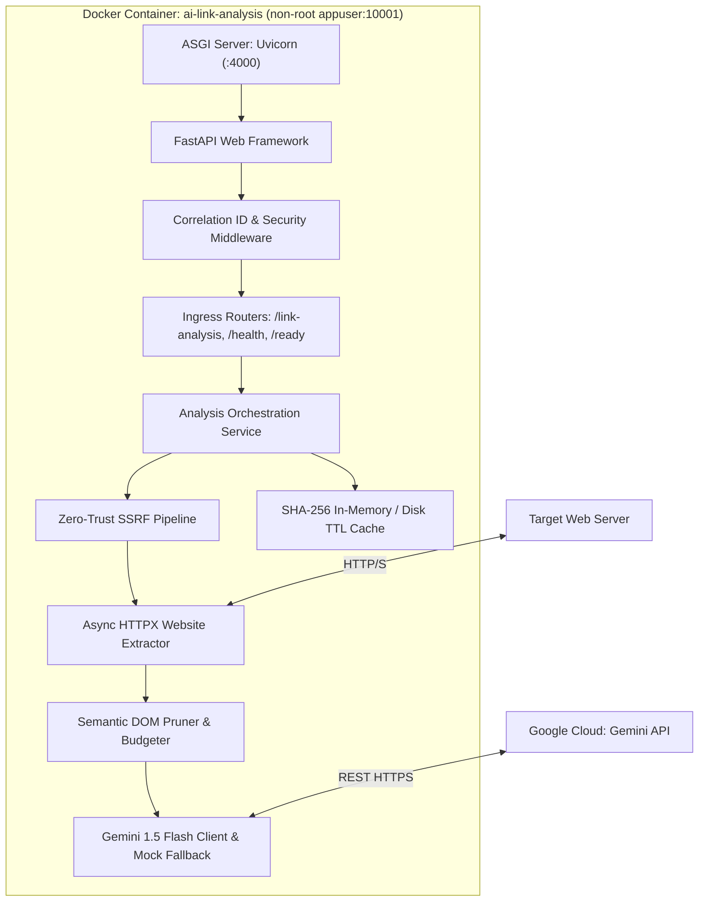
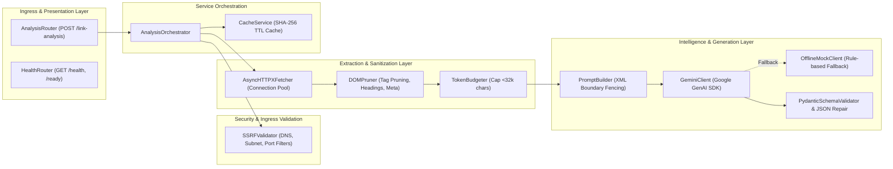

# High-Level Architecture Design (HLD)
## AI-Powered Website Link Analysis API (`ai-link-analysis`)

> **Author:** Piyush Makhija (Technical Lead / Senior Software Engineer)  
> **Client / Evaluator:** Dxora Technologies (`hr@chivoxai.com`)  
> **Architecture Pattern:** Clean Layered Microservice Architecture (C4 Model)  
> **Version:** 1.0.0-PROD  
> **Date:** November 2026  

---

## 1. Architectural Principles & System Goals

The architecture of `ai-link-analysis` adheres to five foundational engineering principles:
1. **Clean Layered Separation:** Router $\to$ Security Ingress $\to$ Extractor $\to$ LLM Engine $\to$ Orchestrator. No circular dependencies; upper layers depend on lower-layer abstractions.
2. **Zero-Trust Security by Default:** All inbound URLs and scraped web content are treated as potentially malicious (SSRF defense, prompt injection isolation, memory limits).
3. **Token Economics & Cost Optimization:** Multi-stage DOM pruning and character budgeting guarantee high semantic density under 8,000 tokens ($0.001/request).
4. **Resilience & Fault Isolation:** Bulkhead isolation and deterministic offline mock fallbacks guarantee the API never crashes when credentials or upstream websites fail.
5. **Observability & Traceability:** Request correlation tracing (`X-Correlation-ID`), structured JSON logging, and RFC 7807 problem details across all interactions.

---

## 2. C4 Model Architecture

### 2.1 C4 Level 1: System Context Diagram



### 2.2 C4 Level 2: Container Diagram



### 2.3 C4 Level 3: Component Diagram



---

## 3. Data Flow & Execution Sequence DAG

```
1. Client POST /link-analysis {url: "..."}
2. Correlation Middleware: Generate/Propagate UUIDv4 X-Correlation-ID
3. Cache Check: Compute SHA-256(normalized_url) -> Cache Hit? Return HTTP 200 (2ms)
4. URL Syntax Validation: Verify RFC 3986 format & http/https protocol
5. SSRF Defense:
   a. Resolve hostname via socket.getaddrinfo()
   b. Check all IPs against IP blacklist (RFC 1918, RFC 3927 link-local, loopback, CGNAT)
   c. Check port whitelist (80, 443 only)
6. Asynchronous Fetch:
   a. Dispatch HTTPX async GET with desktop User-Agent
   b. Enforce 10s connection/read SLA timeout
   c. Stream chunks up to 5MB max payload cap
7. DOM Pruning & Semantic Extraction:
   a. Strip <script>, <style>, <noscript>, <svg>, <iframe>, navbars, footers, dialogs
   b. Extract <title>, meta description, OpenGraph tags, schema.org JSON-LD
   c. Extract headings <h1>-<h3> and main content paragraphs
   d. Enforce character ceiling (<32,000 characters / ~8,000 tokens)
8. Prompt Fencing & LLM Invocation:
   a. Enclose pruned content in <untrusted_scraped_website_content> tags
   b. Dispatch single-pass 5-section prompt to Google Gemini 1.5 Flash
   c. Enforce native JSON schema mode with negative zero search volume constraints
9. Response Validation & Schema Repair:
   a. Parse JSON into Pydantic v2 LinkAnalysisResponse
   b. On formatting error, execute deterministic JSON repair fallback loop
10. Cache Store & Response Delivery:
   a. Save response in cache under SHA-256 key
   b. Enrich with telemetry (execution_time_seconds, token_estimates, cost_usd)
   c. Return HTTP 200 OK JSON
```

---

## 4. Architectural Quality Attributes & Cross-Cutting Concerns

| Concern | Implementation Strategy |
|:---|:---|
| **Security** | Zero-trust SSRF validation; XML prompt injection fencing; non-root OCI container; Bandit SAST scanning. |
| **Performance** | Non-blocking HTTPX async operations; single-pass 5-in-1 consolidated LLM query; SHA-256 response caching. |
| **Cost Optimization** | Gemini 1.5 Flash ($0.075/1M input); multi-stage DOM tag stripping; character budget caps ($0.001/request). |
| **Maintainability** | Clean architecture; Strategy, Factory, and Adapter patterns; Level 2.2 Docstrings-Only (Rule 12). |
| **Observability** | Centralized JSON logging; correlation ID propagation; SRE liveness and readiness probes; token telemetry. |
