# Architecture Deep-Dive: RFC 7807 Problem Details & Domain Exception Hierarchy

> **Author:** Piyush Makhija (Technical Lead / Senior Software Engineer)  
> **Client / Evaluator:** Dxora Technologies (`hr@chivoxai.com`)  
> **Repository:** [https://github.com/piyushmakhija28/ai-link-analysis](https://github.com/piyushmakhija28/ai-link-analysis)  
> **Version:** 1.0.0-PROD  
> **Date:** November 2026  
> **Status:** Baselined & Enforced  

---

## 1. Executive Summary & Design Rationale

Under Section 8 of the Dxora Technologies practical test specification, API client errors and server faults must return standardized, machine-readable diagnostic details without leaking internal implementation details (such as stack traces, database credentials, or server file paths).

Our service implements **IETF RFC 7807 Problem Details for HTTP APIs** (`Content-Type: application/problem+json`). Every domain error maps to a formal URI `type`, an HTTP status code, a human-readable title, an explanatory detail message, the request instance URI, and an asynchronous correlation ID.

---

## 2. Domain Exception Class Hierarchy

All application errors inherit from an abstract base class `LinkAnalysisBaseException`:

```mermaid
classDiagram
    class Exception
    class LinkAnalysisBaseException {
        +int status_code
        +str error_code
        +str title
        +str detail
        +to_problem_details(instance, correlation_id) dict
    }
    class InvalidTargetURLError {
        +status_code = 400
        +error_code = "ERR_INVALID_URL"
    }
    class UnsupportedSchemeError {
        +status_code = 400
        +error_code = "ERR_UNSUPPORTED_SCHEME"
    }
    class SSRFSecurityViolationError {
        +status_code = 400
        +error_code = "ERR_SSRF_BLOCKED"
    }
    class DisallowedPortError {
        +status_code = 400
        +error_code = "ERR_DISALLOWED_PORT"
    }
    class PayloadTooLargeError {
        +status_code = 413
        +error_code = "ERR_PAYLOAD_TOO_LARGE"
    }
    class EmptyWebsiteContentError {
        +status_code = 422
        +error_code = "ERR_EMPTY_WEBSITE_CONTENT"
    }
    class UpstreamWebsiteUnreachableError {
        +status_code = 502
        +error_code = "ERR_WEBSITE_UNREACHABLE"
    }
    class UpstreamWebsiteTimeoutError {
        +status_code = 504
        +error_code = "ERR_UPSTREAM_TIMEOUT"
    }
    class LLMSynthesisError {
        +status_code = 502
        +error_code = "ERR_LLM_SYNTHESIS_FAILED"
    }

    Exception <|-- LinkAnalysisBaseException
    LinkAnalysisBaseException <|-- InvalidTargetURLError
    LinkAnalysisBaseException <|-- UnsupportedSchemeError
    LinkAnalysisBaseException <|-- SSRFSecurityViolationError
    LinkAnalysisBaseException <|-- DisallowedPortError
    LinkAnalysisBaseException <|-- PayloadTooLargeError
    LinkAnalysisBaseException <|-- EmptyWebsiteContentError
    LinkAnalysisBaseException <|-- UpstreamWebsiteUnreachableError
    LinkAnalysisBaseException <|-- UpstreamWebsiteTimeoutError
    LinkAnalysisBaseException <|-- LLMSynthesisError
```



---

## 3. RFC 7807 Standard Error Schema & Examples

### 3.1 Formal JSON Schema
```json
{
  "type": "urn:dxora:error:ssrf-blocked",
  "title": "SSRF Security Violation",
  "status": 400,
  "detail": "Target URL resolves to blacklisted cloud metadata or private IP range: 169.254.169.254",
  "instance": "/link-analysis",
  "code": "ERR_SSRF_BLOCKED",
  "correlation_id": "c9a1b2c3-4d5e-6f7a-8b9c-0d1e2f3a4b5c",
  "timestamp": "2026-11-22T07:45:00.123Z",
  "remediation": "Target a publicly routable internet web domain. Internal infrastructure access is forbidden."
}
```

### 3.2 Error Code Mapping Table

| HTTP Status | Error Code | Machine Title | Root Cause Trigger |
|:---:|:---|:---|:---|
| **400** | `ERR_INVALID_URL` | Invalid Target URL | URL failed RFC 3986 syntax validation or exceeded 2,048 chars. |
| **400** | `ERR_UNSUPPORTED_SCHEME` | Unsupported Protocol Scheme | Ingress scheme is not `http` or `https` (e.g. `file://`, `ftp://`). |
| **400** | `ERR_SSRF_BLOCKED` | SSRF Security Violation | Resolved IP falls within private RFC 1918, loopback, or metadata CIDRs. |
| **400** | `ERR_DISALLOWED_PORT` | Non-Standard Port Disallowed | Destination port is not 80 or 443. |
| **413** | `ERR_PAYLOAD_TOO_LARGE` | Response Payload Exceeds Ceiling | Target website HTML response stream exceeded 5MB ceiling. |
| **422** | `ERR_EMPTY_WEBSITE_CONTENT` | Insufficient Extractable Text | Website yielded zero semantic text after DOM pruning. |
| **502** | `ERR_WEBSITE_UNREACHABLE` | Upstream Website Inaccessible | DNS lookup failed or target web server returned HTTP 4xx/5xx error. |
| **504** | `ERR_UPSTREAM_TIMEOUT` | Website Fetch Timeout Exceeded | Target website failed to respond within 10.0-second SLA timeout. |
| **502** | `ERR_LLM_SYNTHESIS_FAILED` | Generative Synthesis Failure | LLM providers failed and offline fallback was unavailable. |
| **500** | `ERR_INTERNAL_SERVER_ERROR` | Internal System Anomaly | Unhandled internal exception; masked from user. |

---

## 4. FastAPI Global Exception Handlers

To guarantee that raw Starlette or Pydantic validation errors are transformed into RFC 7807 envelopes, FastAPI registers global exception interceptors:

```python
@app.exception_handler(LinkAnalysisBaseException)
async def domain_exception_handler(
    request: Request, exc: LinkAnalysisBaseException
):
    correlation_id = get_correlation_id()
    problem = exc.to_problem_details(
        instance=str(request.url.path),
        correlation_id=correlation_id,
    )
    return JSONResponse(
        status_code=exc.status_code,
        content=problem,
        media_type="application/problem+json",
        headers={"X-Correlation-ID": correlation_id},
    )
```

---
*End of Exception Handling Architecture. Authored by Piyush Makhija for Dxora Technologies Evaluation.*
