# Architecture Deep-Dive: Exception Handling & RFC 7807 Standard

> **Author:** Piyush Makhija (Technical Lead / Senior Software Engineer)  
> **Client / Evaluator:** Dxora Technologies (`hr@chivoxai.com`)  
> **Version:** 1.0.0-PROD  
> **Date:** November 2026  

---

## 1. RFC 7807 Problem Details Standard

All client and server error responses returned by the microservice adhere strictly to **IETF RFC 7807 (Problem Details for HTTP APIs)** with content-type `application/problem+json`:

```json
{
  "type": "https://errors.ailinkanalysis.com/ssrf-violation",
  "title": "SSRF Security Violation",
  "status": 400,
  "detail": "Target URL resolves to a prohibited private network address (10.0.0.1).",
  "instance": "/link-analysis",
  "correlation_id": "c9a1b2c3-4d5e-6f7a-8b9c-0d1e2f3a4b5c",
  "timestamp": "2026-11-22T07:45:00Z"
}
```

---

## 2. Domain Exception Hierarchy

```mermaid
graph TD
    Root["LinkAnalysisException (Base Exception)"]
    
    Root --> Ingress["IngressValidationException (400/422)"]
    Ingress --> S1["InvalidUrlSchemeException (400)"]
    Ingress --> S2["MalformedUrlException (422)"]
    
    Root --> Sec["SecurityViolationException (400)"]
    Sec --> SC1["SsrfViolationException (400)"]
    Sec --> SC2["ProhibitedPortException (400)"]
    Sec --> SC3["DnsResolutionException (400)"]
    
    Root --> Ext["WebsiteExtractionException (502/504)"]
    Ext --> E1["WebsiteTimeoutException (504)"]
    Ext --> E2["WebsiteUnreachableException (502)"]
    Ext --> E3["WebsiteAccessDeniedException (502)"]
    Ext --> E4["WebsitePayloadTooLargeException (413)"]
    
    Root --> AI["LLMServiceException (502/503)"]
    AI --> A1["LLMRateLimitException (429)"]
    AI --> A2["LLMTimeoutException (504)"]
    AI --> A3["LLMAuthenticationException (502)"]
    AI --> A4["LLMSchemaValidationException (502)"]
```



---

## 3. Global Exception Handler Mapping

| Exception Class | HTTP Status | Problem Title | Problem Type URI |
|:---|:---:|:---|:---|
| `InvalidUrlSchemeException` | 400 | Invalid URL Scheme | `https://errors.ailinkanalysis.com/invalid-scheme` |
| `SsrfViolationException` | 400 | SSRF Security Violation | `https://errors.ailinkanalysis.com/ssrf-violation` |
| `ProhibitedPortException` | 400 | Prohibited Port | `https://errors.ailinkanalysis.com/prohibited-port` |
| `DnsResolutionException` | 400 | DNS Resolution Failure | `https://errors.ailinkanalysis.com/dns-failure` |
| `WebsitePayloadTooLargeException` | 413 | Payload Too Large | `https://errors.ailinkanalysis.com/payload-too-large` |
| `WebsiteTimeoutException` | 504 | Upstream Gateway Timeout | `https://errors.ailinkanalysis.com/upstream-timeout` |
| `WebsiteUnreachableException` | 502 | Bad Gateway (Website Unreachable) | `https://errors.ailinkanalysis.com/website-unreachable` |
| `WebsiteAccessDeniedException` | 502 | Bad Gateway (Upstream 401/403) | `https://errors.ailinkanalysis.com/website-access-denied` |
| `LLMRateLimitException` | 429 | AI Provider Rate Limited | `https://errors.ailinkanalysis.com/ai-rate-limited` |
| `LLMServiceException` | 502 | AI Generation Error | `https://errors.ailinkanalysis.com/ai-generation-error` |
| `Unhandled Internal Exception` | 500 | Internal Server Error | `https://errors.ailinkanalysis.com/internal-error` |
