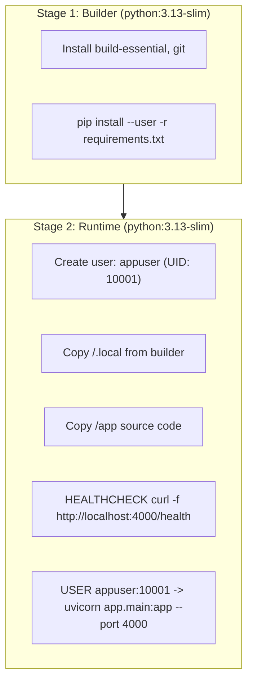

# DevOps Architecture: Multi-Stage Non-Root Containerization

> **Author:** Piyush Makhija (Technical Lead / Senior Software Engineer)  
> **Client / Evaluator:** Dxora Technologies (`hr@chivoxai.com`)  
> **Version:** 1.0.0-PROD  
> **Date:** November 2026  

---

## 1. Container Security & Multi-Stage Architecture

The Docker container adheres to production OCI security standards:
1. **Multi-Stage Build:** Stage 1 (`builder`) compiles dependencies and installs wheels; Stage 2 (`runtime`) contains strictly the minimal distroless/slim runtime layer without build tools, minimizing image size and attack surface.
2. **Non-Root Execution:** The process executes under unprivileged user `appuser` (UID: 10001, GID: 10001).
3. **Native Docker HEALTHCHECK:** Built-in health check periodically evaluates `http://localhost:4000/health`.
4. **Read-Only Root Filesystem Ready:** Writable operations are restricted to temp/cache directories.



---

## 2. Dockerfile Specification

```dockerfile
# Multi-stage non-root OCI Dockerfile
FROM python:3.13-slim AS builder

WORKDIR /build
ENV PYTHONDONTWRITEBYTECODE=1 \
    PYTHONUNBUFFERED=1

RUN apt-get update && apt-get install -y --no-install-recommends \
    gcc \
    && rm -rf /var/lib/apt/lists/*

COPY requirements.txt .
RUN pip install --no-cache-dir --user -r requirements.txt

# Final Runtime Stage
FROM python:3.13-slim AS runtime

WORKDIR /app
ENV PYTHONDONTWRITEBYTECODE=1 \
    PYTHONUNBUFFERED=1 \
    PATH="/home/appuser/.local/bin:$PATH"

RUN groupadd -g 10001 appgroup && \
    useradd -u 10001 -g appgroup -s /bin/bash -m appuser && \
    apt-get update && apt-get install -y --no-install-recommends curl && \
    rm -rf /var/lib/apt/lists/*

COPY --from=builder /root/.local /home/appuser/.local
COPY app /app/app

RUN chown -R appuser:appgroup /app /home/appuser

USER 10001:10001
EXPOSE 4000

HEALTHCHECK --interval=30s --timeout=5s --start-period=5s --retries=3 \
    CMD curl -f http://localhost:4000/health || exit 1

CMD ["uvicorn", "app.main:app", "--host", "0.0.0.0", "--port", "4000"]
```
