# DevOps Architecture: Automated GitHub Actions CI/CD Pipeline

> **Author:** Piyush Makhija (Technical Lead / Senior Software Engineer)  
> **Client / Evaluator:** Dxora Technologies (`hr@chivoxai.com`)  
> **Version:** 1.0.0-PROD  
> **Date:** November 2026  

---

## 1. CI/CD Pipeline Architecture

The automated continuous integration pipeline is defined in `.github/workflows/ci.yml`. It runs on every push and pull request against `main`.

```mermaid
graph LR
    Push["Push / PR to main"] --> Checkout["Checkout Code"]
    Checkout --> SetupPy["Setup Python 3.13 & Cache"]
    SetupPy --> Install["Install Dependencies"]
    Install --> Lint["Linter Check (Ruff)"]
    Lint --> Format["Format Check (Black)"]
    Format --> Typecheck["Type Check (Mypy --strict)"]
    Typecheck --> SAST["Security SAST (Bandit)"]
    SAST --> Test["Triad Tests & Coverage (Pytest >=90%)"]
    Test --> Docker["Docker Build Verification"]
```

---

## 2. Quality Gates Matrix

| Stage | Tool | Command Executed | Quality Gate SLA |
|:---|:---|:---|:---|
| **Linting** | Ruff | `ruff check app/ tests/` | 0 errors, 0 warnings. |
| **Formatting** | Black | `black --check app/ tests/` | 100% compliant code format. |
| **Type Safety** | Mypy | `mypy --strict app/` | 0 type errors. |
| **Security SAST** | Bandit | `bandit -r app/ -ll -s B104` | 0 high or medium vulnerabilities. |
| **Test Coverage** | Pytest + Coverage | `pytest --cov=app --cov-report=term-missing --cov-fail-under=90` | 100% passing tests, $\ge 90\%$ statement coverage. |
| **Container Build** | Docker | `docker build -t ai-link-analysis .` | Successful OCI non-root build. |
