# DevOps Architecture: Automated GitHub Actions CI/CD Quality Pipeline

> **Author:** Piyush Makhija (Technical Lead / Senior Software Engineer)  
> **Client / Evaluator:** Dxora Technologies (`hr@chivoxai.com`)  
> **Repository:** [https://github.com/piyushmakhija28/ai-link-analysis](https://github.com/piyushmakhija28/ai-link-analysis)  
> **Version:** 1.0.0-PROD  
> **Date:** November 2026  
> **Status:** Baselined & Enforced  

---

## 1. CI/CD Architecture & Quality Gate Flow

The Continuous Integration pipeline is implemented in `.github/workflows/ci.yml`. It runs on every `push` and `pull_request` targeting the `main` branch. 

Merging is strictly gated behind **6 Sequential Quality Gates** tested across a matrix of modern Python runtimes:

```mermaid
flowchart LR
    Push["Git Push / PR to main"] --> Checkout["1. Checkout Code"]
    Checkout --> Setup["2. Setup Python Matrix (3.10, 3.11, 3.12, 3.13)"]
    Setup --> Cache["3. Restore Pip Cache"]
    Cache --> Install["4. Install Dependencies"]
    
    subgraph QualityGates["6 Enforced Zero-Defect Quality Gates"]
        Install --> G1["Gate 1: Black Code Format Check"]
        G1 --> G2["Gate 2: Ruff Linter (0 Warnings)"]
        G2 --> G3["Gate 3: Mypy Strict Typing (0 Errors)"]
        G3 --> G4["Gate 4: Bandit SAST Security Scan"]
        G4 --> G5["Gate 5: Pytest Triad Tests (>=90% Coverage)"]
        G5 --> G6["Gate 6: Multi-Stage Docker Build Test"]
    end
    
    G6 --> Success["All Gates Green -> Auto-Deploy to Render.com"]
```



---

## 2. Granular Quality Gates Matrix

| Gate ID | Quality Domain | Validation Engine | Execution Command | Strict Failure Threshold |
|:---:|:---|:---|:---|:---|
| **G-01** | Code Formatting | **Black** | `black --check app/ tests/` | Any unformatted file blocks merge. |
| **G-02** | Static Linting | **Ruff** | `ruff check app/ tests/` | Any lint rule violation blocks merge. |
| **G-03** | Static Typing | **Mypy** | `mypy --strict app/` | Any untyped or `Any` type blocks merge. |
| **G-04** | Security SAST | **Bandit** | `bandit -r app/ -ll -s B104` | Any High or Medium vulnerability blocks merge. |
| **G-05** | Test Suite & Coverage | **Pytest + Cov** | `pytest --cov=app --cov-report=term-missing --cov-fail-under=90` | <90% statement coverage or single test failure blocks merge. |
| **G-06** | Container Verification | **Docker Buildx** | `docker build -t ai-link-analysis:test .` | Any container build error blocks merge. |

---

## 3. Complete GitHub Actions Workflow Specification (`.github/workflows/ci.yml`)

```yaml
name: CI Quality Gate Pipeline

on:
  push:
    branches: [ main ]
  pull_request:
    branches: [ main ]

jobs:
  validate-and-test:
    runs-on: ubuntu-latest
    strategy:
      matrix:
        python-version: ["3.10", "3.11", "3.12", "3.13"]

    steps:
      - name: Checkout Repository
        uses: actions/checkout@v4

      - name: Set up Python ${{ matrix.python-version }}
        uses: actions/setup-python@v5
        with:
          python-version: ${{ matrix.python-version }}
          cache: 'pip'

      - name: Install Dependencies
        run: |
          python -m pip install --upgrade pip
          pip install -r requirements.txt
          pip install ruff black mypy bandit pytest pytest-asyncio pytest-cov httpx

      - name: Gate 1: Code Formatting Check (Black)
        run: black --check app tests

      - name: Gate 2: Linter Inspection (Ruff)
        run: ruff check app tests

      - name: Gate 3: Strict Type Checking (Mypy)
        run: mypy --strict app

      - name: Gate 4: Security SAST Audit (Bandit)
        run: bandit -r app -ll -s B104

      - name: Gate 5: Triad Test Suite & Coverage (Pytest >=90%)
        run: pytest --cov=app --cov-report=term-missing --cov-fail-under=90

  docker-build:
    needs: validate-and-test
    runs-on: ubuntu-latest
    steps:
      - name: Checkout Repository
        uses: actions/checkout@v4

      - name: Set up Docker Buildx
        uses: docker/setup-buildx-action@v3

      - name: Gate 6: Build Multi-Stage Docker Container
        uses: docker/build-push-action@v5
        with:
          context: .
          push: false
          tags: ai-link-analysis:latest
```

---
*End of CI/CD Pipeline Specification. Authored by Piyush Makhija for Dxora Technologies Evaluation.*
