# Low-Level Design: Class Architecture, Typing & Object Contracts

> **Author:** Piyush Makhija (Technical Lead / Senior Software Engineer)  
> **Client / Evaluator:** Dxora Technologies (`hr@chivoxai.com`)  
> **Repository:** [https://github.com/piyushmakhija28/ai-link-analysis](https://github.com/piyushmakhija28/ai-link-analysis)  
> **Version:** 1.0.0-PROD  
> **Date:** November 2026  
> **Status:** Baselined & Enforced  

---

## 1. Complete UML Class Architecture

```mermaid
classDiagram
    class Settings {
        +str app_name
        +str app_env
        +int port
        +str gemini_api_key
        +str openai_api_key
        +str primary_llm_model
        +str fallback_llm_model
        +int max_content_length
        +float request_timeout_seconds
        +int cache_ttl_seconds
        +list~int~ allowed_ports
        +list~str~ allowed_schemes
        +bool is_gemini_configured() bool
        +bool is_openai_configured() bool
    }

    class SSRFValidator {
        +validate_target_url(url: str) ValidatedUrlTarget
        -_validate_scheme(scheme: str) None
        -_validate_port(port: Optional~int~, scheme: str) int
        -_resolve_and_validate_ips(hostname: str) list~ipaddress.IPv4Address | ipaddress.IPv6Address~
        -_is_ip_blacklisted(ip: ipaddress.IPv4Address | ipaddress.IPv6Address) bool
    }

    class BaseWebsiteExtractor {
        <<interface>>
        +fetch_and_prune(url: str, correlation_id: str) PrunedDocument*
    }

    class AsyncHTTPXWebsiteExtractor {
        -httpx.AsyncClient _client
        -DOMPruner _pruner
        +fetch_and_prune(url: str, correlation_id: str) PrunedDocument
        -_stream_html(url: str) tuple~str, str~
    }

    class DOMPruner {
        -int _max_character_budget
        +prune(raw_html: str, target_url: str) PrunedDocument
        -_strip_unwanted_tags(soup: BeautifulSoup) None
        -_extract_head_metadata(soup: BeautifulSoup) WebsiteMetadata
        -_extract_body_headings_and_text(soup: BeautifulSoup) str
        -_truncate_to_budget(text: str) str
    }

    class BaseLLMClient {
        <<interface>>
        +analyze(document: PrunedDocument, correlation_id: str) LinkAnalysisPayload*
        +get_provider_name() str*
    }

    class GeminiLLMClient {
        -genai.Client _client
        -str _model_name
        +analyze(document: PrunedDocument, correlation_id: str) LinkAnalysisPayload
        +get_provider_name() str
        -_build_fenced_prompt(document: PrunedDocument) str
        -_execute_with_retry(prompt: str) str
    }

    class OpenAIMiniLLMClient {
        -openai.AsyncOpenAI _client
        -str _model_name
        +analyze(document: PrunedDocument, correlation_id: str) LinkAnalysisPayload
        +get_provider_name() str
        -_build_fenced_prompt(document: PrunedDocument) str
    }

    class OfflineMockClient {
        +analyze(document: PrunedDocument, correlation_id: str) LinkAnalysisPayload
        +get_provider_name() str
        -_synthesize_competitors(meta: WebsiteMetadata) CompetitorAnalysis
        -_synthesize_search_queries(meta: WebsiteMetadata) list~TargetSearchQuery~
        -_synthesize_seo_strategy(meta: WebsiteMetadata) SEOStrategy
        -_synthesize_services(meta: WebsiteMetadata) list~ServiceCapability~
        -_synthesize_target_audience(meta: WebsiteMetadata) TargetAudienceProfile
    }

    class LLMClientFactory {
        +create_primary_client(settings: Settings) BaseLLMClient$
        +create_fallback_client(settings: Settings) BaseLLMClient$
    }

    class CircuitBreaker {
        -int _failure_threshold
        -float _recovery_timeout_seconds
        -CircuitState _state
        -int _failure_count
        -float _last_failure_time
        +call(coroutine_func, *args, **kwargs) Any
        +trip() None
        +reset() None
        +get_state() CircuitState
    }

    class AnalysisCacheService {
        -dict~str, tuple~LinkAnalysisResponse, float~~ _cache
        -int _default_ttl_seconds
        +get(url: str) Optional~LinkAnalysisResponse~
        +set(url: str, response: LinkAnalysisResponse, ttl: Optional~int~) None
        +clear() None
        -_canonicalize_and_hash(url: str) str
    }

    class AnalysisOrchestrator {
        -SSRFValidator _ssrf_validator
        -BaseWebsiteExtractor _extractor
        -BaseLLMClient _primary_llm
        -BaseLLMClient _fallback_llm
        -CircuitBreaker _circuit_breaker
        -AnalysisCacheService _cache_service
        +analyze_link(request: LinkAnalysisRequest, correlation_id: str) LinkAnalysisResponse
        -_assemble_telemetry(...) TelemetryData
    }

    BaseWebsiteExtractor <|.. AsyncHTTPXWebsiteExtractor
    AsyncHTTPXWebsiteExtractor --> DOMPruner
    BaseLLMClient <|.. GeminiLLMClient
    BaseLLMClient <|.. OpenAIMiniLLMClient
    BaseLLMClient <|.. OfflineMockClient
    LLMClientFactory ..> BaseLLMClient
    AnalysisOrchestrator --> SSRFValidator
    AnalysisOrchestrator --> BaseWebsiteExtractor
    AnalysisOrchestrator --> BaseLLMClient
    AnalysisOrchestrator --> CircuitBreaker
    AnalysisOrchestrator --> AnalysisCacheService
```



---

## 2. Invariant Contracts & Complete Method Signatures

### 2.1 SSRF Validator Contract
```python
from typing import Optional, List
import ipaddress
from pydantic import BaseModel


class ValidatedUrlTarget(BaseModel):
    """Immutable value object holding verified URL and pre-flight IP addresses."""

    original_url: str
    canonical_url: str
    scheme: str
    hostname: str
    port: int
    resolved_ips: List[ipaddress.IPv4Address | ipaddress.IPv6Address]


class SSRFValidator:
    """Zero-trust security validator preventing SSRF and private network access."""

    async def validate_target_url(self, url: str) -> ValidatedUrlTarget:
        """Validate URL syntax, scheme, port, and pre-flight IP subnet safety.

        Args:
            url: Raw target website URL string.

        Returns:
            ValidatedUrlTarget with canonical URL and verified public IPs.

        Raises:
            InvalidTargetURLError: If syntax is invalid or scheme is disallowed.
            SSRFSecurityViolationError: If IP resolves to loopback, private, or metadata CIDRs.
            DisallowedPortError: If port is not 80 or 443.
        """
        ...
```

### 2.2 Website Extractor & DOM Pruner Contract
```python
from typing import Dict, Any, Optional
from pydantic import BaseModel


class WebsiteMetadata(BaseModel):
    """Extracted high-signal HTML head metadata."""

    title: Optional[str] = None
    meta_description: Optional[str] = None
    og_title: Optional[str] = None
    og_description: Optional[str] = None
    json_ld: Optional[Dict[str, Any]] = None


class PrunedDocument(BaseModel):
    """Cleaned, semantic website content with bounded character count."""

    target_url: str
    metadata: WebsiteMetadata
    headings_markdown: str
    core_text_content: str
    total_characters: int
    estimated_tokens: int


class BaseWebsiteExtractor(ABC):
    """Abstract interface defining website fetching and DOM pruning."""

    @abstractmethod
    async def fetch_and_prune(
        self, url: str, correlation_id: str
    ) -> PrunedDocument:
        """Stream website HTML, enforce 5MB limit, prune DOM, and budget tokens.

        Args:
            url: Validated public website URL.
            correlation_id: Request tracing UUID.

        Returns:
            PrunedDocument with <8,000 token content context.

        Raises:
            UpstreamWebsiteTimeoutError: If fetch exceeds 10.0s SLA.
            PayloadTooLargeError: If response body exceeds 5MB ceiling.
            EmptyWebsiteContentError: If no extractable text is discovered.
            UpstreamWebsiteUnreachableError: On connection/DNS failure.
        """
        ...
```

### 2.3 LLM Client Contract & Pydantic Schema Steering
```python
class BaseLLMClient(ABC):
    """Abstract interface for generative business intelligence synthesis."""

    @abstractmethod
    async def analyze(
        self, document: PrunedDocument, correlation_id: str
    ) -> LinkAnalysisPayload:
        """Execute single-pass multi-section prompt and return structured payload.

        Args:
            document: Cleaned website content and metadata.
            correlation_id: Request tracing UUID.

        Returns:
            Validated LinkAnalysisPayload containing all 5 business intelligence sections.

        Raises:
            LLMSynthesisError: If provider fails and no fallback succeeds.
        """
        ...

    @abstractmethod
    def get_provider_name(self) -> str:
        """Return the machine-readable name of the LLM provider."""
        ...
```

---
*End of Low-Level Design: Class Architecture. Authored by Piyush Makhija for Dxora Technologies Evaluation.*
