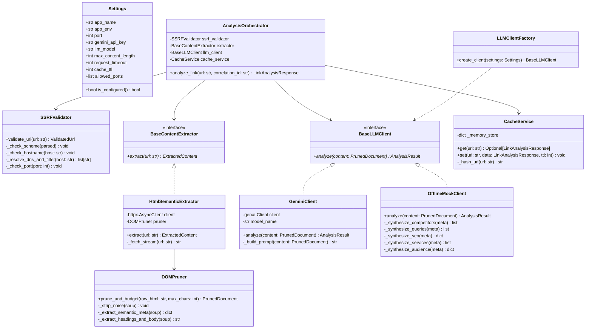

# Low-Level Design: Class Architecture & Object Contracts

> **Author:** Piyush Makhija (Technical Lead / Senior Software Engineer)  
> **Client / Evaluator:** Dxora Technologies (`hr@chivoxai.com`)  
> **Version:** 1.0.0-PROD  
> **Date:** November 2026  

---

## 1. Core Class Diagram & Structure



---

## 2. Key Interface Signatures

### 2.1 Content Extractor Interface
```python
from abc import ABC, abstractmethod
from app.schemas import PrunedDocument


class BaseContentExtractor(ABC):
    """Abstract interface defining the contract for web content extraction."""

    @abstractmethod
    async def extract(self, url: str) -> PrunedDocument:
        """Asynchronously extract and prune semantic content from target URL.

        Args:
            url: Validated public website URL.

        Returns:
            PrunedDocument containing title, meta, headings, and bounded body text.

        Raises:
            WebsiteExtractionException: On HTTP/network failure.
        """
        pass
```

### 2.2 LLM Client Interface
```python
from abc import ABC, abstractmethod
from app.schemas import AnalysisResult, PrunedDocument


class BaseLLMClient(ABC):
    """Abstract interface defining the contract for business intelligence extraction."""

    @abstractmethod
    async def analyze(self, content: PrunedDocument) -> AnalysisResult:
        """Analyze pruned website document and extract 5 structured BI sections.

        Args:
            content: Pruned semantic website text and metadata.

        Returns:
            AnalysisResult with all 5 verified BI sections.

        Raises:
            LLMServiceException: On API rate-limit, auth, or schema parsing error.
        """
        pass
```
