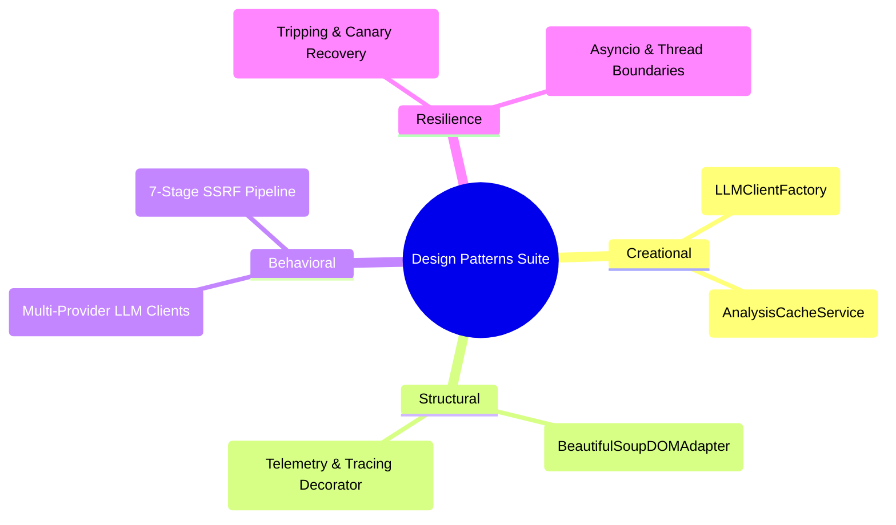
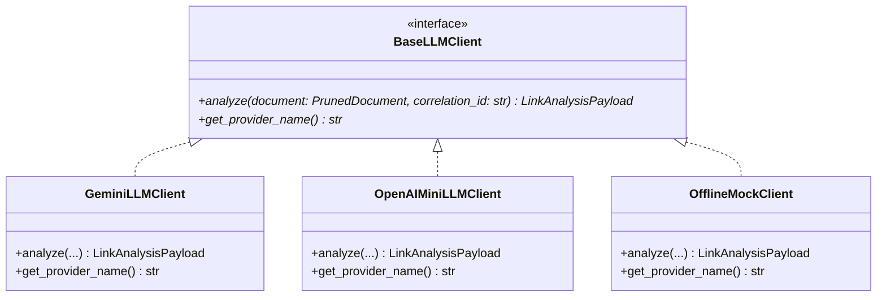
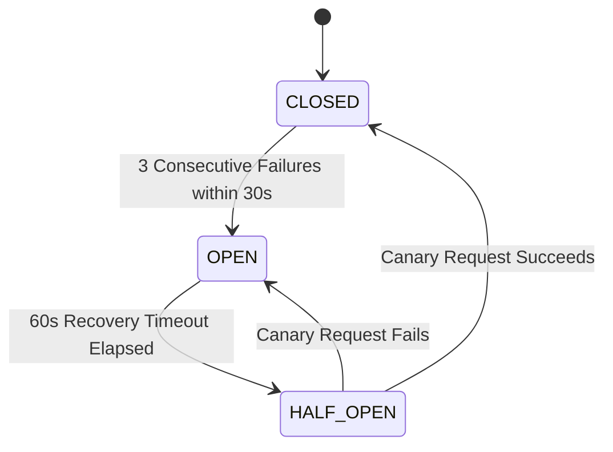

# Low-Level Design: Design Patterns & Architectural Idioms

> **Author:** Piyush Makhija (Technical Lead / Senior Software Engineer)  
> **Client / Evaluator:** Dxora Technologies (`hr@chivoxai.com`)  
> **Repository:** [https://github.com/piyushmakhija28/ai-link-analysis](https://github.com/piyushmakhija28/ai-link-analysis)  
> **Version:** 1.0.0-PROD  
> **Date:** November 2026  
> **Status:** Baselined & Enforced  

---

## 1. Executive Summary

The `ai-link-analysis` microservice implements an ensemble of proven **Gang of Four (GoF)** object-oriented patterns and **Cloud-Native Resilience Patterns**. This ensures loose coupling, testability without external network access, seamless multi-provider failover, and strict defense-in-depth.



---

## 2. Detailed Pattern Specifications

### 2.1 Strategy Pattern (Interchangeable LLM Inference Engines)
- **Problem:** Tightly coupling business intelligence synthesis to a single vendor (Google Gemini) creates vendor lock-in and leaves the application vulnerable if Google experiences transient 429 rate limits or regional outages.
- **Solution:** Define an abstract strategy contract `BaseLLMClient` with concrete implementations:
  1. `GeminiLLMClient`: Primary strategy utilizing Google Gemini 1.5 Flash with native `response_schema` steering.
  2. `OpenAIMiniLLMClient`: Secondary fallback strategy using OpenAI GPT-4o-mini with strict `json_schema`.
  3. `OfflineMockClient`: Deterministic rule-based strategy generating structured synthetic payloads for local development, CI/CD pipelines, and unconfigured environments.
- **UML Realization:**


---

### 2.2 Factory Method Pattern (`LLMClientFactory`)
- **Problem:** Instantiating LLM clients requires inspecting environment settings (`GEMINI_API_KEY`, `OPENAI_API_KEY`), configuring timeouts, and selecting correct SDK client wrappers without leaking initialization logic into business routers.
- **Solution:** A centralized factory `LLMClientFactory` encapsulates client creation logic:
```python
class LLMClientFactory:
    """Factory creating appropriate LLM strategy based on runtime configuration."""

    @staticmethod
    def create_primary_client(settings: Settings) -> BaseLLMClient:
        """Create primary Gemini 1.5 Flash client or fallback to mock."""
        if settings.is_gemini_configured():
            return GeminiLLMClient(
                api_key=settings.gemini_api_key,
                model_name=settings.primary_llm_model,
            )
        return OfflineMockClient()

    @staticmethod
    def create_fallback_client(settings: Settings) -> BaseLLMClient:
        """Create secondary fallback client (OpenAI GPT-4o-mini) or mock."""
        if settings.is_openai_configured():
            return OpenAIMiniLLMClient(
                api_key=settings.openai_api_key,
                model_name=settings.fallback_llm_model,
            )
        return OfflineMockClient()
```

---

### 2.3 Circuit Breaker Pattern (Fault-Tolerant Provider Failover)
- **Problem:** If Google Gemini API returns persistent 429 rate limits or 503 gateway errors, awaiting a 5-second timeout on every request will cause cascading request queue buildup.
- **Solution:** Implement a 3-state Circuit Breaker (`CLOSED`, `OPEN`, `HALF-OPEN`):

- **State Semantics:**
  - `CLOSED`: Normal operation. Invocations route directly to `GeminiLLMClient`.
  - `OPEN`: Circuit tripped. Invocations bypass Gemini immediately and execute on `OpenAIMiniLLMClient` or `OfflineMockClient`.
  - `HALF-OPEN`: A single probe request tests Gemini recovery. Success resets the failure counter to 0 and transitions back to `CLOSED`.

---

### 2.4 Chain of Responsibility Pattern (7-Stage SSRF Validation Pipeline)
- **Problem:** Multiple security rules must inspect an incoming target URL. If any stage fails, the inspection must halt immediately with a specific error code.
- **Solution:** Sequential handler chain:

```mermaid
flowchart LR
    URL["Raw Inbound URL"] --> H1["Handler 1: Syntax & RFC 3986 Length Check"]
    H1 -->|Pass| H2["Handler 2: Scheme Whitelist (http/https only)"]
    H2 -->|Pass| H3["Handler 3: Port Whitelist (80/443 only)"]
    H3 -->|Pass| H4["Handler 4: Hostname Format & Punycode Normalization"]
    H4 -->|Pass| H5["Handler 5: Pre-Flight Asynchronous DNS Resolution"]
    H5 -->|Pass| H6["Handler 6: IPv4 / IPv6 Subnet Blacklist Match"]
    H6 -->|Pass| H7["Handler 7: DNS Rebinding / Pinning Check"]
    H7 -->|Pass| OK["Validated Public Target TargetUrl"]
```


---

### 2.5 Decorator Pattern (Execution Telemetry & Structured Tracing)
- **Problem:** Latency tracking, token consumption estimation, and calculated USD/INR costs need to be recorded uniformly without polluting business algorithms.
- **Solution:** Asynchronous telemetry decorator wrapping service operations:
```python
def with_telemetry(operation_name: str):
    """Decorator recording execution latency and correlating with request context."""

    def decorator(func):
        @functools.wraps(func)
        async def wrapper(*args, **kwargs):
            start = time.perf_counter()
            correlation_id = get_correlation_id()
            try:
                result = await func(*args, **kwargs)
                latency = time.perf_counter() - start
                logger.info(
                    "Operation completed successfully",
                    extra={
                        "operation": operation_name,
                        "latency_ms": latency * 1000,
                        "correlation_id": correlation_id,
                    },
                )
                return result
            except Exception as exc:
                latency = time.perf_counter() - start
                logger.error(
                    "Operation failed",
                    extra={
                        "operation": operation_name,
                        "latency_ms": latency * 1000,
                        "error": str(exc),
                        "correlation_id": correlation_id,
                    },
                )
                raise

        return wrapper

    return decorator
```

---
*End of Low-Level Design: Design Patterns. Authored by Piyush Makhija for Dxora Technologies Evaluation.*
