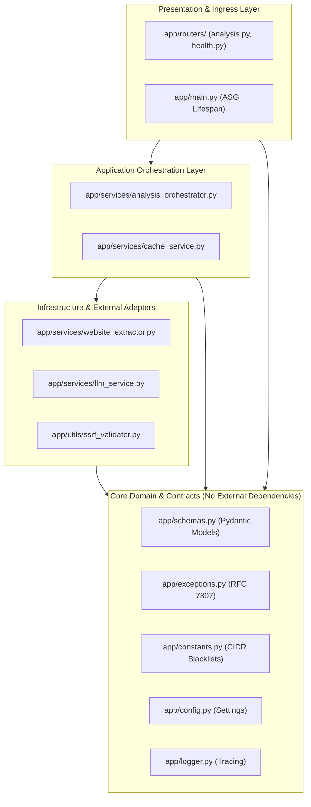

# Low-Level Design: Python Package Structure & Clean Architecture Rules

> **Author:** Piyush Makhija (Technical Lead / Senior Software Engineer)  
> **Client / Evaluator:** Dxora Technologies (`hr@chivoxai.com`)  
> **Repository:** [https://github.com/piyushmakhija28/ai-link-analysis](https://github.com/piyushmakhija28/ai-link-analysis)  
> **Version:** 1.0.0-PROD  
> **Date:** November 2026  
> **Status:** Baselined & Enforced  

---

## 1. Directory Tree & Physical Module Organization

The project follows the standard **Clean Architecture** directory layout, enforcing a strict unidirectional dependency hierarchy where domain rules and schemas remain completely decoupled from external frameworks and network transports:

```text
ai-link-analysis/
├── app/
│   ├── __init__.py                     # Package root, version definition
│   ├── main.py                         # ASGI entry point, FastAPI lifespan, middleware & routes
│   ├── config.py                       # Pydantic v2 BaseSettings, environment loader
│   ├── constants.py                    # Network blacklists, regexes, port whitelists
│   ├── schemas.py                      # Pure domain models, Pydantic schemas, Enums
│   ├── exceptions.py                   # RFC 7807 problem details exception hierarchy
│   ├── logger.py                       # Structured JSON logging, contextvars correlation ID
│   ├── routers/
│   │   ├── __init__.py                 # Router package export
│   │   ├── analysis.py                 # POST /link-analysis controller
│   │   └── health.py                   # GET /health (liveness), GET /ready (readiness)
│   ├── services/
│   │   ├── __init__.py                 # Service layer exports
│   │   ├── analysis_orchestrator.py    # Master workflow coordinator (DAG execution)
│   │   ├── website_extractor.py        # Asynchronous HTTPX client & DOM pruner
│   │   ├── llm_service.py              # Gemini 1.5 Flash client, prompt fencer & mock fallback
│   │   └── cache_service.py            # In-memory SHA-256 URL TTL cache
│   └── utils/
│       ├── __init__.py                 # Utilities exports
│       ├── ssrf_validator.py           # 7-stage zero-trust SSRF validation pipeline
│       └── token_counter.py            # Approximate token estimation and cost calculator
├── tests/
│   ├── __init__.py                     # Test package
│   ├── conftest.py                     # Pytest fixtures, mock transports, synthetic HTML
│   ├── test_schemas.py                 # Domain schema triad unit tests
│   ├── test_ssrf_validator.py          # SSRF security pipeline triad tests
│   ├── test_website_extractor.py       # Async HTTPX & DOM pruner triad tests
│   ├── test_llm_service.py             # LLM client & mock fallback triad tests
│   ├── test_cache_service.py           # Cache hit/expiration triad tests
│   ├── test_exceptions.py              # RFC 7807 exception handler triad tests
│   ├── test_health_probes.py           # SRE liveness and readiness triad tests
│   ├── test_router_analysis.py         # Ingress endpoint triad unit tests
│   └── test_integration.py             # End-to-end triad integration test suite
├── docs/                               # Comprehensive architecture documentation
├── uml/                                # 13 Mermaid UML diagrams
├── Dockerfile                          # Multi-stage non-root OCI container
├── docker-compose.yml                  # Local development orchestration
├── render.yaml                         # Infrastructure-as-Code Render.com blueprint
├── pyproject.toml                      # Modern Python packaging & tool configuration
├── requirements.txt                    # Pinned production dependencies
├── .env.example                        # Documented environment template
└── README.md                           # Master project guide
```

---

## 2. Unidirectional Dependency Rule (Clean Architecture)



### Dependency Invariants:
1. **Domain Layer Independence:** `app/schemas.py`, `app/constants.py`, and `app/exceptions.py` MUST NOT import from `routers/` or `services/`.
2. **Circular Import Prohibition:** Circular imports between `services/` modules are strictly prevented by passing data via pure value objects (`PrunedDocument`, `ValidatedUrlTarget`).
3. **Public API Exports:** Every package `__init__.py` explicitly defines `__all__` to control encapsulation and prevent accidental leakage of internal implementation details.

---
*End of Low-Level Design: Package Structure. Authored by Piyush Makhija for Dxora Technologies Evaluation.*
