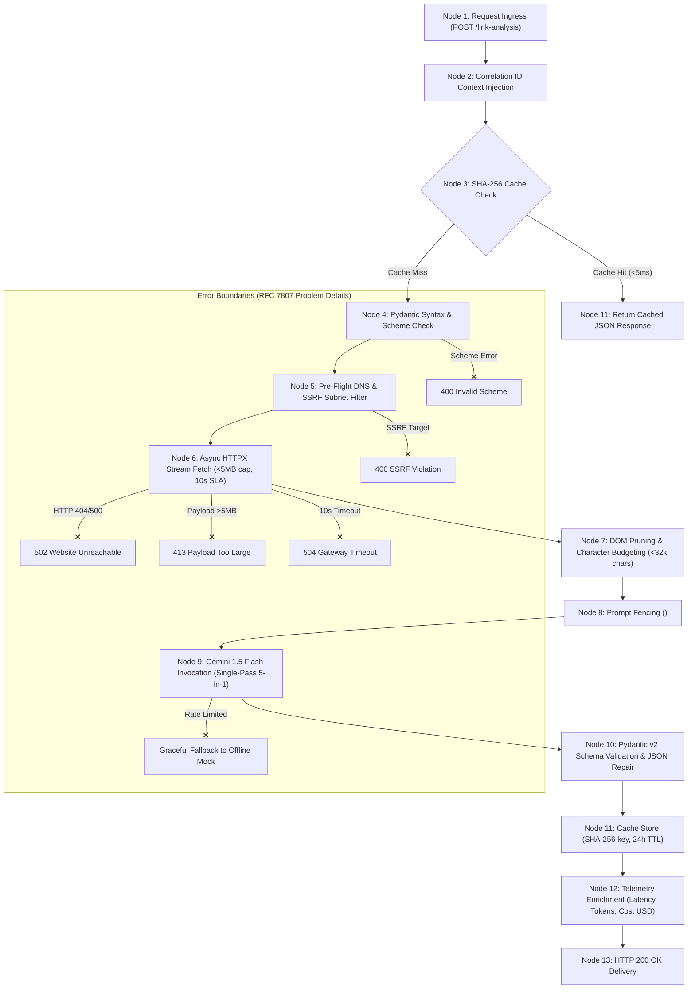

# Governance Architecture: Service Directed Acyclic Graph (DAG)

> **Author:** Piyush Makhija (Technical Lead / Senior Software Engineer)  
> **Client / Evaluator:** Dxora Technologies (`hr@chivoxai.com`)  
> **Version:** 1.0.0-PROD  
> **Date:** November 2026  

---

## 1. Service Directed Acyclic Graph (DAG)

The internal execution graph is strictly acyclic with defined error boundaries:

