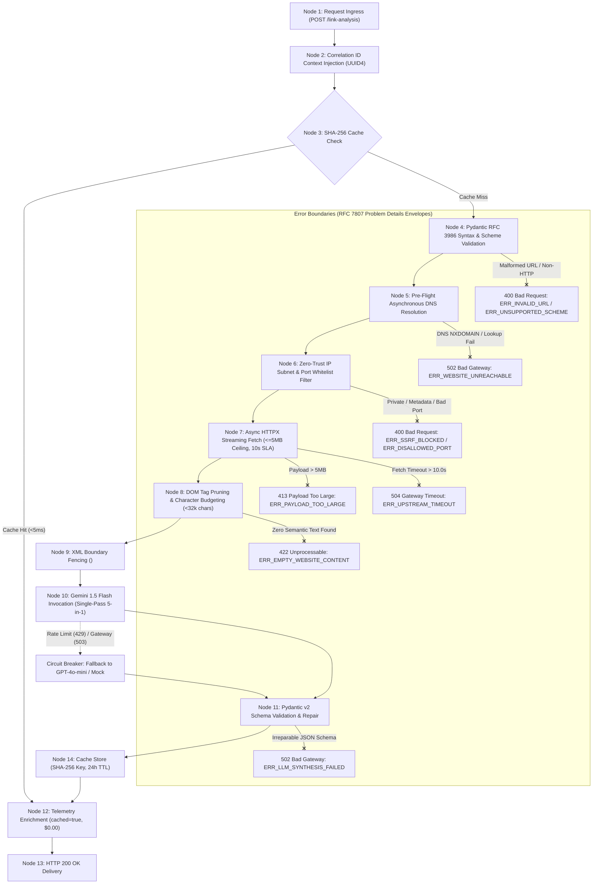

# Governance Architecture: Service Directed Acyclic Graph (DAG) & Latency Budgeting

> **Author:** Piyush Makhija (Technical Lead / Senior Software Engineer)  
> **Client / Evaluator:** Dxora Technologies (`hr@chivoxai.com`)  
> **Repository:** [https://github.com/piyushmakhija28/ai-link-analysis](https://github.com/piyushmakhija28/ai-link-analysis)  
> **Version:** 1.0.0-PROD  
> **Date:** November 2026  
> **Status:** Baselined & Enforced  

---

## 1. Executive Summary & Purpose

The **Service Directed Acyclic Graph (DAG)** defines the exact execution topology, concurrency boundaries, latency budget allocations, and error recovery transitions for the `ai-link-analysis` microservice.

Execution is strictly deterministic and acyclic: requests enter at Node 1 (Ingress) and flow sequentially or conditionally toward Node 13 (Delivery) with well-defined error boundaries mapping failures directly to RFC 7807 problem details responses.

---

## 2. Complete Microservice Execution DAG

---

## 3. Granular Node Execution & Latency Budget Allocation

Total End-to-End SLA Ceiling: **5,000ms** (Typical Uncached Execution: **~1,450ms**; Cached Execution: **~2ms**).

| Node ID | Node Name | Operation Description | P50 Latency | P95 Latency | Hard Timeout Ceiling | Failure Action |
|:---:|:---|:---|:---:|:---:|:---:|:---|
| **N1** | Ingress Router | JSON deserialization, HTTP body extraction | 1ms | 2ms | 100ms | 400 Bad Request |
| **N2** | Context Injection | Generate UUID4, set `contextvars` correlation ID | 0.1ms | 0.5ms | 5ms | Default fallback UUID |
| **N3** | SHA-256 Cache Check | Hash normalized URL, query in-memory dictionary | 0.2ms | 0.8ms | 5ms | Proceed to Node 4 (Miss) |
| **N4** | Syntax & Scheme Check | Pydantic regex validation, verify `http` or `https` | 1ms | 3ms | 10ms | 400 ERR_UNSUPPORTED_SCHEME |
| **N5** | Pre-Flight DNS | Async `socket.getaddrinfo` via thread pool executor | 8ms | 25ms | 2,000ms | 502 ERR_WEBSITE_UNREACHABLE |
| **N6** | IP Subnet Blacklist | Match resolved IPs against CIDR trees & port check | 0.5ms | 1.5ms | 10ms | 400 ERR_SSRF_BLOCKED |
| **N7** | Async HTTPX Fetch | Stream GET response, track chunks up to 5MB | 450ms | 1,200ms | 10,000ms | 413 / 504 / 502 |
| **N8** | DOM Tag Pruning | BeautifulSoup script/style stripping & budgeting | 12ms | 35ms | 500ms | 422 ERR_EMPTY_WEBSITE_CONTENT |
| **N9** | XML Prompt Fencing | Assemble single-pass prompt with XML delimiters | 0.5ms | 1.0ms | 10ms | Proceed to Node 10 |
| **N10** | Gemini 1.5 Flash | Structured generative inference with schema steering | 950ms | 1,800ms | 4,500ms | Trip Circuit Breaker (CB) |
| **CB** | Circuit Breaker Fallback | Fallback to GPT-4o-mini or OfflineMockClient | 5ms (Mock) | 1,200ms (GPT) | 3,000ms | 502 ERR_LLM_SYNTHESIS_FAILED |
| **N11** | Schema Validation | Validate raw JSON into `LinkAnalysisPayload` | 2ms | 5ms | 50ms | Attempt JSON repair |
| **N14** | Cache Store | Store validated model under SHA-256 key with TTL | 0.2ms | 0.5ms | 10ms | Log warning, continue |
| **N12** | Telemetry Enrichment | Compute latency, token usage, cost in USD/INR | 0.2ms | 0.5ms | 5ms | Attach defaults |
| **N13** | HTTP Delivery | FastAPI response serialization, set headers | 1ms | 3ms | 50ms | Return 200 OK |

---

## 4. Bulkhead Resilience & Concurrency Boundaries

To ensure that high concurrency or slow external websites never degrade the microservice, the system enforces strict architectural bulkheads:
1. **Connection Pooling Limits:** `httpx.AsyncClient(limits=httpx.Limits(max_keepalive_connections=20, max_connections=100))`.
2. **DNS Thread Isolation:** Blocking DNS lookups are offloaded to `run_in_executor(None, ...)` to ensure the asyncio event loop remains non-blocking.
3. **Memory Ceiling Protection:** Streaming chunk reads abort after 5MB, preventing high-concurrency memory exhaustion (OOM crashes).
4. **Circuit Breaker State Machine:**
   - **CLOSED (Normal):** All traffic routes to Google Gemini 1.5 Flash.
   - **OPEN (Tripped):** After 3 consecutive 429/503 errors within 30 seconds, requests immediately route to OpenAI GPT-4o-mini / OfflineMockClient without waiting for Gemini timeouts.
   - **HALF-OPEN (Canary):** After 60-second recovery cooldown, a single canary request tests Gemini. If successful, circuit resets to CLOSED.
