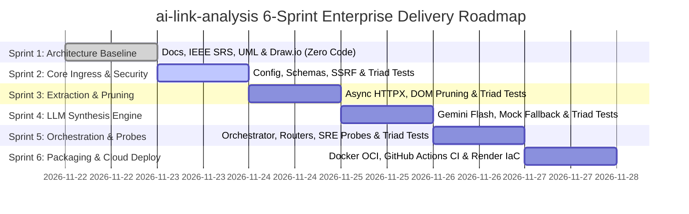

# Governance Architecture: 6-Sprint Delivery Roadmap & Milestone DoD

> **Author:** Piyush Makhija (Technical Lead / Senior Software Engineer)  
> **Client / Evaluator:** Dxora Technologies (`hr@chivoxai.com`)  
> **Repository:** [https://github.com/piyushmakhija28/ai-link-analysis](https://github.com/piyushmakhija28/ai-link-analysis)  
> **Version:** 1.0.0-PROD  
> **Date:** November 2026  
> **Status:** Baselined & Enforced  

---

## 1. 6-Sprint Milestone Delivery Roadmap

---

## 2. Granular Sprint Specifications & Definition of Done (DoD)

### Sprint 1: Architecture Baseline, Specifications & Diagram Suite
- **GitHub Milestone:** Milestone 1 (Closed) | **Issues:** #1, #2 (Closed)
- **Primary Deliverables:**
  - IEEE Std 830-1998 System Requirements Specification (`SRS.md`).
  - Product Requirements Document (`docs/01-prd.md`) with personas, journeys, and edge cases.
  - High-Level Design (`docs/02-hld.md`) with C4 Context, Container, and Component models.
  - Complete Architectural Decision Records (`docs/06-adr/ADR-001` through `ADR-008`).
  - Formal OpenAPI 3.1.0 Contract (`openapi.yaml`).
  - 13 Mermaid UML Diagrams (`uml/`) and 8 Native Editable Draw.io Diagrams (`docs/diagrams/`).
  - LLM Model Research & Unit Economics Benchmark (`docs/architecture/llm-model-research-benchmark.md`).
- **Definition of Done (DoD):**
  - [x] Zero application code written in `app/`.
  - [x] All 34+ documentation files authored, verified, and cross-referenced.
  - [x] Merged to `main` via PR #13 and git tag `v0.1.0-baseline`.

---

### Sprint 2: Core Ingress Models, Settings & Zero-Trust SSRF Defense Pipeline
- **GitHub Milestone:** Milestone 2 (Active) | **Issues:** #3, #4, #5
- **Primary Deliverables:**
  - `app/config.py`: Environment configuration via `pydantic-settings` (`GEMINI_API_KEY`, `OPENAI_API_KEY`, `PORT=4000`, `CACHE_TTL=86400`, `LOG_LEVEL=INFO`).
  - `app/constants.py`: Subnet blacklists (RFC 1918, RFC 3927, RFC 6598, IPv6, cloud metadata `169.254.169.254`), allowed schemes (`http`, `https`), and ports (`80`, `443`).
  - `app/schemas.py`: Pydantic v2 domain schemas (`LinkAnalysisRequest`, `LinkAnalysisResponse`, `CompetitorAnalysis`, `TargetSearchQuery`, `SEOStrategy`, `ServiceCapability`, `TargetAudienceProfile`, `TelemetryData`).
  - `app/exceptions.py`: RFC 7807 problem details domain exception hierarchy (`LinkAnalysisError`, `SSRFSecurityViolationError`, `InvalidTargetURLError`, `UpstreamWebsiteTimeoutError`, `PayloadTooLargeError`).
  - `app/utils/ssrf_validator.py`: 7-stage pre-flight DNS and IP subnet validation pipeline with TOCTOU mitigation.
- **Definition of Done (DoD):**
  - [ ] Strict Level 2.2 Docstrings-Only convention (zero inline `#` narration comments).
  - [ ] 100% type coverage passing `mypy --strict` with zero type errors.
  - [ ] Pytest triad unit tests in `tests/test_ssrf_validator.py` and `tests/test_schemas.py` achieving $\ge 90\%$ statement coverage.
  - [ ] Security scans with `bandit -r app/ -ll -s B104` returning 0 vulnerabilities.

---

### Sprint 3: Resilient Asynchronous Website Extractor & Semantic DOM Pruner
- **GitHub Milestone:** Milestone 3 (Open) | **Issues:** #6, #7
- **Primary Deliverables:**
  - `app/services/website_extractor.py`: Asynchronous HTTPX client with connection pooling, browser user-agent headers, and redirect validation.
  - Streaming payload limiter aborting responses exceeding 5MB (returning HTTP 413).
  - 10.0-second cumulative upstream connection and read timeout enforcer (returning HTTP 504).
  - Semantic DOM tag pruner stripping `<script>`, `<style>`, `<nav>`, `<footer>`, `<svg>`, and cookie dialogs.
  - Ingress character/token budget capper restricting extracted body context to $\le 32,000$ characters (~8,000 tokens).
- **Definition of Done (DoD):**
  - [ ] Mock transport tests in `tests/test_website_extractor.py` covering standard 200 OK, 403 bot blocks, 5MB ceiling aborts, 10s timeouts, and DOM pruning.
  - [ ] Statement test coverage $\ge 90\%$.

---

### Sprint 4: Google Gemini 1.5 Flash LLM Service & Structured BI Extraction
- **GitHub Milestone:** Milestone 4 (Open) | **Issues:** #8, #9
- **Primary Deliverables:**
  - `app/services/llm_service.py`: Google GenAI SDK integration with native `response_schema` steering and `response_mime_type="application/json"`.
  - Single-pass consolidated 5-in-1 prompt with XML boundary fencing (`<untrusted_scraped_website_content>`).
  - Negative prompt constraint and Pydantic field exclusion strictly eliminating hallucinated search volumes.
  - Automated circuit breaker fallback to OpenAI `gpt-4o-mini` and deterministic `OfflineMockClient`.
  - Real-time token usage estimation and calculated USD/INR cost telemetry.
- **Definition of Done (DoD):**
  - [ ] Pytest triad tests in `tests/test_llm_service.py` verifying single-pass prompt composition, XML fencing, mock generation, and cost calculations.
  - [ ] Zero API calls executed during automated unit testing ($0.00 cost).

---

### Sprint 5: Analysis Orchestrator, Routers & End-to-End Integration
- **GitHub Milestone:** Milestone 5 (Open) | **Issues:** #10, #11
- **Primary Deliverables:**
  - `app/services/cache_service.py`: In-memory SHA-256 URL hash cache with 24-hour TTL (`CACHE_TTL=86400`).
  - `app/services/analysis_orchestrator.py`: Central coordination DAG managing cache, SSRF checks, scraping, LLM invocation, and telemetry assembly.
  - `app/routers/analysis.py`: Primary endpoint `POST /link-analysis`.
  - `app/routers/health.py`: SRE health probes (`GET /health` liveness and `GET /ready` readiness).
  - `app/logger.py`: Centralized structured JSON logging with async `contextvars` correlation ID injection.
  - `app/main.py`: FastAPI ASGI application instance, RFC 7807 global exception handlers, and CORS/correlation middleware.
- **Definition of Done (DoD):**
  - [ ] Full triad integration tests in `tests/test_integration.py` achieving $\ge 90\%$ statement coverage across the entire application.
  - [ ] Swagger documentation live and validated at `http://localhost:4000/docs`.

---

### Sprint 6: Production Packaging, CI/CD Pipeline & Cloud Deployment Blueprint
- **GitHub Milestone:** Milestone 6 (Open) | **Issue:** #12
- **Primary Deliverables:**
  - `Dockerfile`: Multi-stage non-root OCI container running under unprivileged user `appuser:10001` with native Docker health checks.
  - `docker-compose.yml`: Local orchestrator with port mapping (`4000:4000`) and environment variable bindings.
  - `.github/workflows/ci.yml`: Automated CI/CD pipeline executing Black, Ruff, Mypy strict, Bandit SAST, and Pytest coverage across Python 3.10–3.13.
  - `render.yaml`: Infrastructure-as-Code blueprint for zero-downtime deployment on Render.com.
  - `README.md` & Submission Artifacts: Complete verification walkthrough, curl commands, and submission readiness report.
- **Definition of Done (DoD):**
  - [ ] Docker container builds cleanly with size $\le 150$MB and runs without root privileges.
  - [ ] GitHub Actions CI passes 100% green on all matrix jobs.
  - [ ] Final 10/10 zero-defect evaluation sign-off.
