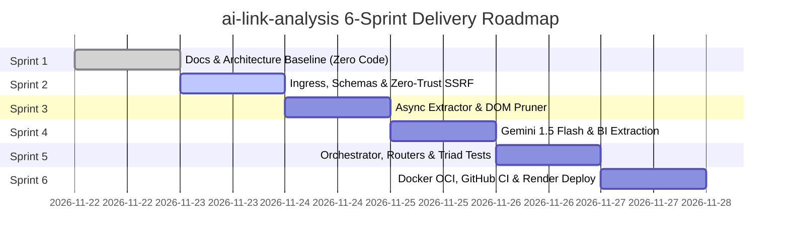

# Governance Architecture: Sprint Roadmap & Milestone Delivery

> **Author:** Piyush Makhija (Technical Lead / Senior Software Engineer)  
> **Client / Evaluator:** Dxora Technologies (`hr@chivoxai.com`)  
> **Version:** 1.0.0-PROD  
> **Date:** November 2026  

---

## 1. Sprint Roadmap across 6 Milestones

---

## 2. Milestone Deliverables Summary

- **Milestone 1 (Sprint 1):** Architecture Baseline, IEEE 830 SRS, 8 ADRs, 13 Mermaid UML diagrams, 8 Draw.io diagrams, OpenAPI 3.1.0 contract.
- **Milestone 2 (Sprint 2):** Config, constants, domain schemas, RFC 7807 problem details, SSRF validator with triad unit tests.
- **Milestone 3 (Sprint 3):** Async HTTPX streaming client, BeautifulSoup4 semantic pruner, token budgeting, with mock transport triad tests.
- **Milestone 4 (Sprint 4):** Google GenAI SDK integration, 5-in-1 consolidated prompt, offline mock fallback, and cost telemetry with triad tests.
- **Milestone 5 (Sprint 5):** Analysis orchestrator, routers (`/link-analysis`, `/health`, `/ready`), correlation ID middleware, full triad tests achieving $\ge 90\%$ coverage.
- **Milestone 6 (Sprint 6):** Multi-stage non-root Dockerfile, `docker-compose.yml`, GitHub Actions CI workflow, Render.com blueprint, live demo verification.
