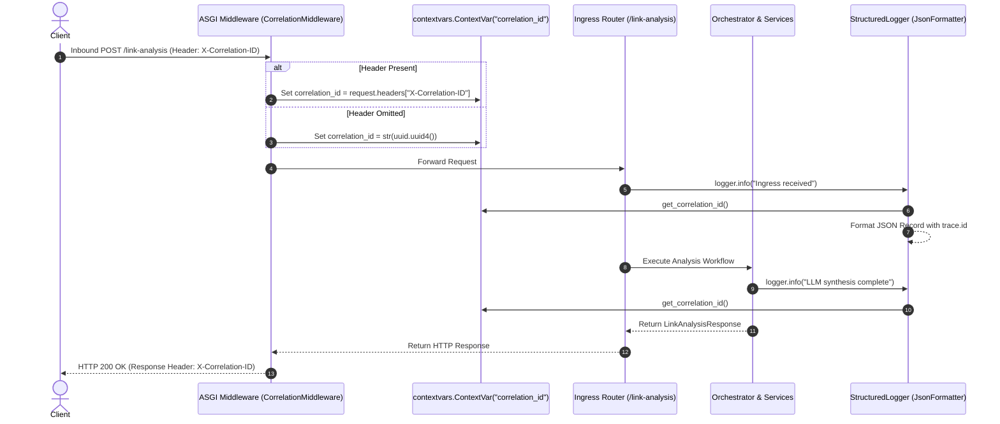

# Observability Architecture: Structured JSON Logging & ECS/OpenTelemetry Mapping

> **Author:** Piyush Makhija (Technical Lead / Senior Software Engineer)  
> **Client / Evaluator:** Dxora Technologies (`hr@chivoxai.com`)  
> **Repository:** [https://github.com/piyushmakhija28/ai-link-analysis](https://github.com/piyushmakhija28/ai-link-analysis)  
> **Version:** 1.0.0-PROD  
> **Date:** November 2026  
> **Status:** Baselined & Enforced  

---

## 1. Principles of Enterprise Observability

In production cloud microservices, plain-text logs and unstructured `print()` statements are anti-patterns:
- They cannot be parsed, indexed, or queried programmatically by log aggregation engines (Elasticsearch, OpenSearch, Datadog, AWS CloudWatch, or Splunk).
- They lack correlation identifiers, making it impossible to trace an asynchronous request across concurrent event loop tasks.
- They risk leaking sensitive environment secrets, internal IPs, or PII.

The `ai-link-analysis` microservice enforces **100% Structured JSON Logging** mapped to **Elastic Common Schema (ECS)** and **OpenTelemetry** logging guidelines.

---

## 2. Formal JSON Log Schema (ECS Compliant)

Every log emitted by the service conforms to the following schema:

```json
{
  "@timestamp": "2026-11-22T07:45:00.123456Z",
  "log.level": "INFO",
  "service.name": "ai-link-analysis",
  "service.version": "1.0.0-PROD",
  "service.environment": "production",
  "trace.id": "c9a1b2c3-4d5e-6f7a-8b9c-0d1e2f3a4b5c",
  "transaction.id": "f47ac10b-58cc-4372-a567-0e02b2c3d4e5",
  "logger": "app.services.analysis_orchestrator",
  "process.thread.id": 140325890,
  "code.filepath": "app/services/analysis_orchestrator.py",
  "code.lineno": 94,
  "code.function": "analyze_link",
  "message": "Website analysis completed successfully.",
  "http.request.method": "POST",
  "url.full": "https://dxora.com",
  "client.ip": "198.51.100.42",
  "llm.provider": "google-gemini",
  "llm.model": "gemini-1.5-flash",
  "llm.tokens.input": 7820,
  "llm.tokens.output": 1410,
  "llm.cost.usd": 0.00101,
  "llm.cost.inr": 0.08686,
  "cache.hit": false,
  "event.duration_ms": 1450.25
}
```

---

## 3. Asynchronous Contextvars Correlation Propagation

FastAPI processes multiple concurrent requests on a single Python thread using asynchronous cooperative multitasking. Traditional thread-local storage (`threading.local`) fails in async code because multiple concurrent coroutines share the same thread.

We use Python's native `contextvars` module to maintain thread-safe, coroutine-isolated correlation context:



---

## 4. Log Redaction & Security Masking

To comply with OWASP security guidelines, the custom `JsonFormatter` automatically masks sensitive values:
1. **API Keys:** Any string matching `GEMINI_API_KEY`, `OPENAI_API_KEY`, or `sk-...` / `AIza...` is replaced with `[REDACTED_API_KEY]`.
2. **Authorization Headers:** Any `Bearer ...` token in headers or query strings is sanitized to `Bearer [REDACTED]`.
3. **Internal IP Addresses:** Any private RFC 1918 IP discovered in error messages is sanitized before output.

---
*End of Structured JSON Logging Specification. Authored by Piyush Makhija for Dxora Technologies Evaluation.*
