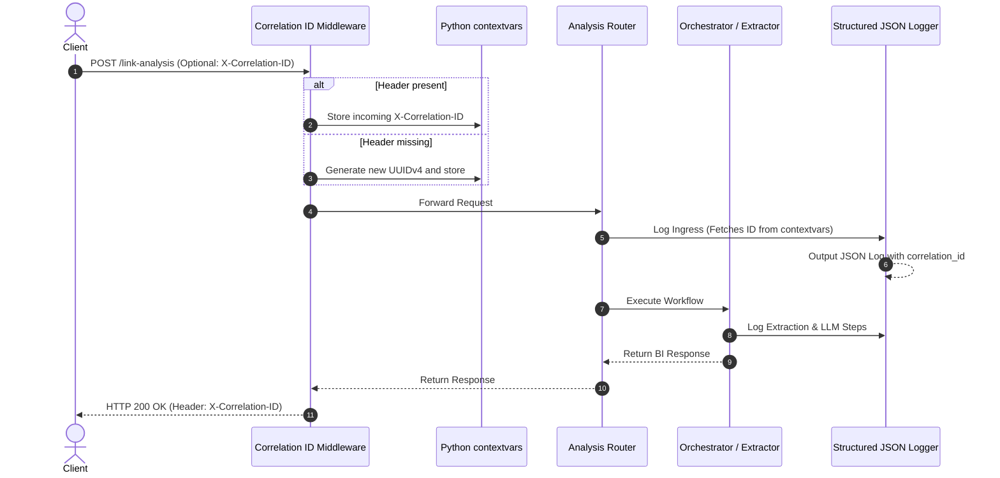

# Observability Architecture: Structured JSON Logging

> **Author:** Piyush Makhija (Technical Lead / Senior Software Engineer)  
> **Client / Evaluator:** Dxora Technologies (`hr@chivoxai.com`)  
> **Version:** 1.0.0-PROD  
> **Date:** November 2026  

---

## 1. Principles of Observability

In production microservices, unstructured text logs and raw `print()` statements are antipatterns. They cannot be indexed, queried, or monitored effectively by Logstash, Datadog, CloudWatch, or Splunk.

`ai-link-analysis` enforces **100% Structured JSON Logging** with:
1. ISO-8601 UTC Timestamps.
2. Distributed tracing correlation IDs (`X-Correlation-ID`) automatically injected from `contextvars`.
3. Standard log levels: `DEBUG`, `INFO`, `WARNING`, `ERROR`, `CRITICAL`.
4. Sanitization: Automatic redaction of sensitive credentials and API keys.

---

## 2. JSON Log Record Schema

```json
{
  "timestamp": "2026-11-22T07:45:00.123Z",
  "level": "INFO",
  "logger": "app.services.analysis_orchestrator",
  "correlation_id": "c9a1b2c3-4d5e-6f7a-8b9c-0d1e2f3a4b5c",
  "module": "analysis_orchestrator",
  "function": "analyze_link",
  "line": 84,
  "message": "Completed website content extraction and business intelligence synthesis.",
  "target_url": "https://example.com",
  "execution_time_seconds": 1.45,
  "input_tokens_estimated": 7820,
  "output_tokens_estimated": 1410,
  "total_cost_usd": 0.00101,
  "ai_model": "gemini-1.5-flash",
  "cache_hit": false
}
```

---

## 3. Correlation ID Propagation Architecture


