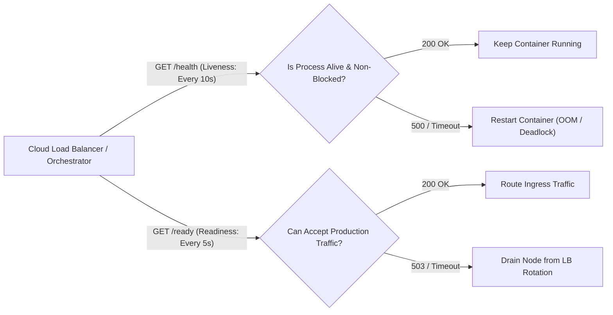

# Observability Architecture: SRE Health Probes & Container Lifecycle

> **Author:** Piyush Makhija (Technical Lead / Senior Software Engineer)  
> **Client / Evaluator:** Dxora Technologies (`hr@chivoxai.com`)  
> **Repository:** [https://github.com/piyushmakhija28/ai-link-analysis](https://github.com/piyushmakhija28/ai-link-analysis)  
> **Version:** 1.0.0-PROD  
> **Date:** November 2026  
> **Status:** Baselined & Enforced  

---

## 1. Cloud-Native SRE Health Probes Overview

In production container orchestration environments (Docker Swarm, Kubernetes, Render.com Web Services), microservices must expose lightweight, standardized health inspection endpoints. 

These probes allow orchestrators to automatically restart deadlocked containers, gracefully pull unready nodes out of load balancer rotation during deployments, and verify dependency health without incurring operational overhead:



---

## 2. Probe Specifications & Endpoint Contracts

### 2.1 Liveness Probe: `GET /health`
- **Objective:** Verifies that the ASGI event loop and Uvicorn worker process are alive, executing cooperative tasks, and not deadlocked.
- **Latency Budget:** $\le 5\text{ms}$. Zero outbound network dependencies.
- **Success Response:** `HTTP 200 OK`
```json
{
  "status": "healthy",
  "uptime_seconds": 14205.8,
  "service": "ai-link-analysis",
  "version": "1.0.0-PROD",
  "environment": "production",
  "timestamp": "2026-11-22T07:45:00Z"
}
```

### 2.2 Readiness Probe: `GET /ready`
- **Objective:** Verifies that the microservice is fully initialized, external network egress is accessible, and the primary or fallback LLM client is ready to receive requests.
- **Success Response:** `HTTP 200 OK`
```json
{
  "status": "ready",
  "llm_provider": "google-gemini",
  "llm_model": "gemini-1.5-flash",
  "circuit_breaker_state": "CLOSED",
  "mock_fallback_active": false,
  "network_egress": "operational",
  "timestamp": "2026-11-22T07:45:00Z"
}
```
- **Failure Response:** `HTTP 503 Service Unavailable` if DNS resolution fails or internal memory threshold exceeds 95%.

---

## 3. Kubernetes & Render.com Probe Configuration

### Kubernetes Deployment Spec:
```yaml
livenessProbe:
  httpGet:
    path: /health
    port: 4000
  initialDelaySeconds: 5
  periodSeconds: 10
  timeoutSeconds: 2
  failureThreshold: 3

readinessProbe:
  httpGet:
    path: /ready
    port: 4000
  initialDelaySeconds: 5
  periodSeconds: 5
  timeoutSeconds: 2
  failureThreshold: 2
```

### Render.com Blueprint (`render.yaml`):
```yaml
healthCheckPath: /health
```
Render automatically polls `/health` during deployments, executing zero-downtime rolling deploys and only directing live user traffic after the new container returns HTTP 200.

---
*End of SRE Health Probes Specification. Authored by Piyush Makhija for Dxora Technologies Evaluation.*
