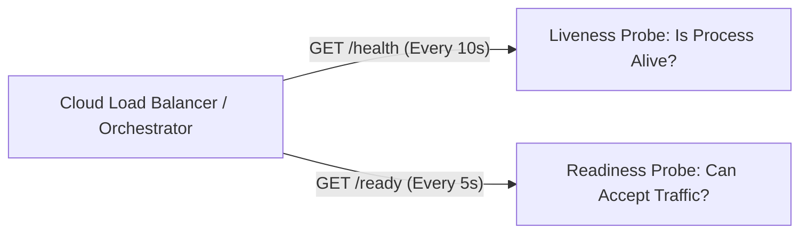

# Observability Architecture: SRE Health & Readiness Probes

> **Author:** Piyush Makhija (Technical Lead / Senior Software Engineer)  
> **Client / Evaluator:** Dxora Technologies (`hr@chivoxai.com`)  
> **Version:** 1.0.0-PROD  
> **Date:** November 2026  

---

## 1. SRE Probes Specification

In modern cloud orchestration environments (Docker Swarm, Kubernetes, Render.com), microservices must expose lightweight health endpoints to manage traffic routing and container lifecycles.



---

## 2. Endpoint Contracts

### 2.1 Liveness Probe: `GET /health`
- **Purpose:** Verifies that the ASGI event loop and Uvicorn process are active and not deadlocked.
- **Response Code:** HTTP 200 OK.
- **Payload Schema:**
```json
{
  "status": "healthy",
  "uptime_seconds": 3600.42,
  "version": "1.0.0-PROD",
  "timestamp": "2026-11-22T07:45:00Z",
  "environment": "production"
}
```

### 2.2 Readiness Probe: `GET /ready`
- **Purpose:** Verifies that external network routing is functional and the LLM engine (Gemini Flash or Offline Mock) is initialized.
- **Response Code:** HTTP 200 OK (Ready) or HTTP 503 Service Unavailable.
- **Payload Schema:**
```json
{
  "status": "ready",
  "llm_provider": "google-gemini",
  "llm_model": "gemini-1.5-flash",
  "mock_mode": false,
  "network_egress": "operational",
  "timestamp": "2026-11-22T07:45:00Z"
}
```
