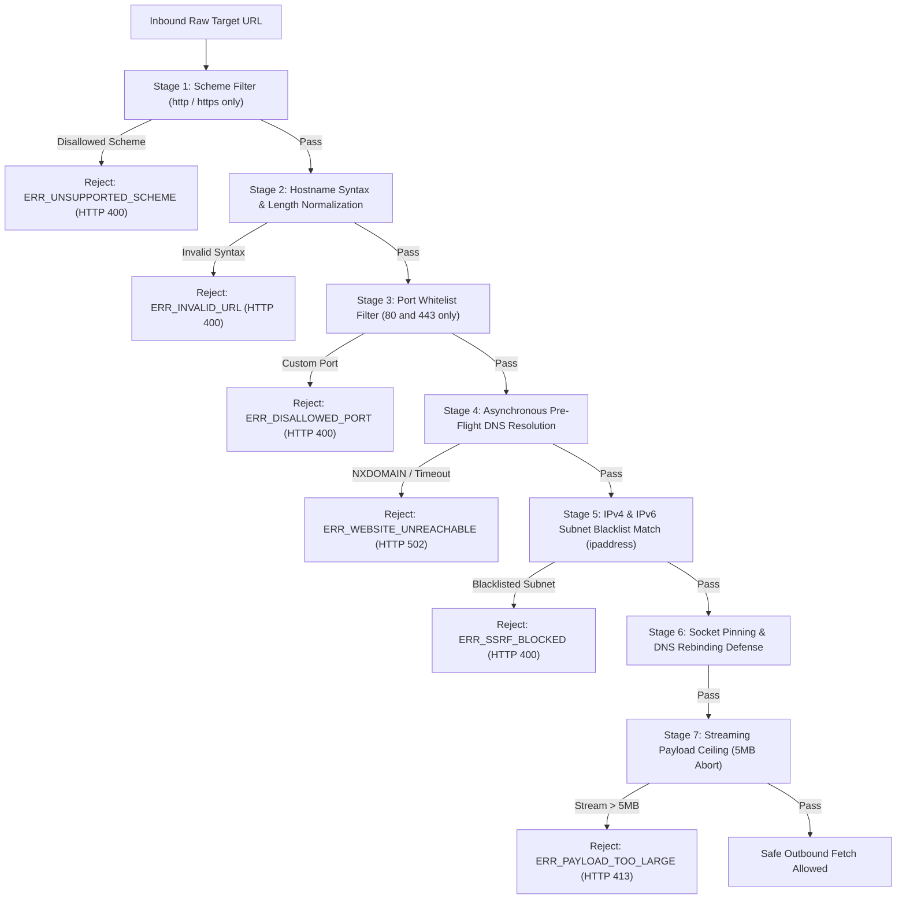

# Security Architecture: 7-Stage Zero-Trust SSRF Defense Specification

> **Author:** Piyush Makhija (Technical Lead / Senior Software Engineer)  
> **Client / Evaluator:** Dxora Technologies (`hr@chivoxai.com`)  
> **Repository:** [https://github.com/piyushmakhija28/ai-link-analysis](https://github.com/piyushmakhija28/ai-link-analysis)  
> **Version:** 1.0.0-PROD  
> **Date:** November 2026  
> **Status:** Baselined & Enforced  

---

## 1. Executive Summary & Problem Formulation

Server-Side Request Forgery (SSRF) is ranked among the most critical cloud vulnerabilities (CWE-918 / OWASP API7:2023). In an application that fetches arbitrary web content on behalf of users, an attacker can manipulate target URLs to coerce the backend server into:
1. Accessing internal cloud metadata endpoints (e.g. `169.254.169.254`) to exfiltrate IAM role credentials, Kubernetes tokens, or environment secrets.
2. Port-scanning and probing internal microservices, private VPC databases, Redis caches, or Docker internal bridge networks (`172.17.0.0/16`).
3. Exploiting Time-of-Check to Time-of-Use (TOCTOU) DNS Rebinding vulnerabilities.

To neutralize these threats, the `ai-link-analysis` microservice enforces an immutable **7-Stage Zero-Trust SSRF Defense Pipeline**:



---

## 2. Granular Stage-by-Stage Defense Architecture

### Stage 1: Scheme Filtering & Protocol Sanitization
- **Requirement:** Ingress scheme MUST be strictly `http` or `https`.
- **Blocked Protocols:** `file://`, `ftp://`, `gopher://`, `dict://`, `ldap://`, `tftp://`, `php://`, `jar://`.
- **Implementation:**
  ```python
  parsed = urllib.parse.urlparse(url)
  if parsed.scheme.lower() not in ("http", "https"):
      raise InvalidUrlSchemeException(f"Scheme '{parsed.scheme}' disallowed.")
  ```

### Stage 2: Hostname Normalization & IDN/Punycode Handling
- **Requirement:** Hostnames must be valid FQDNs or public IP literals.
- **Defenses:** Normalizes Internationalized Domain Names (IDN) via `idna.encode()` to prevent punycode confusion attacks. Strips trailing dots and lowercases hostnames.

### Stage 3: Strict Destination Port Whitelisting
- **Requirement:** Outbound connections are restricted to web ports `80` (HTTP) and `443` (HTTPS).
- **Threat Mitigated:** Prevents port-scanning internal databases or administrative ports (e.g. `:22`, `:3306`, `:5432`, `:6379`, `:8080`, `:9000`).

### Stage 4: Asynchronous Pre-Flight DNS Resolution
- **Requirement:** Hostname must be resolved to all associated IPv4 and IPv6 addresses before establishing a TCP socket.
- **Non-blocking Execution:** Offloaded to thread pool executor via `loop.run_in_executor(None, socket.getaddrinfo, hostname, None)`.

### Stage 5: Comprehensive Subnet Blacklisting
Every resolved IP address is validated against an explicit set of CIDR network objects using Python's `ipaddress.ip_network`:

| Subnet CIDR Range | Specification / Standard | Security Rationale & Threat Prevented |
|:---|:---|:---|
| `127.0.0.0/8`, `::1/128` | RFC 1122 / RFC 4291 Loopback | Access to localhost, ASGI server, and local daemon services. |
| `10.0.0.0/8` | RFC 1918 Private Class A | Access to enterprise private network microservices. |
| `172.16.0.0/12` | RFC 1918 Private Class B | Access to Docker internal bridge networks (`172.17.0.0/16`) and Kubernetes pods. |
| `192.168.0.0/16` | RFC 1918 Private Class C | Access to internal LAN servers and office gateways. |
| `169.254.0.0/16` | RFC 3927 Link-Local | **CRITICAL:** Theft of AWS/GCP/Azure instance metadata (`169.254.169.254`). |
| `fe80::/10` | RFC 4291 IPv6 Link-Local | Traversal of local network segment over IPv6. |
| `100.64.0.0/10` | RFC 6598 Carrier-Grade NAT | Access to shared service provider carrier infrastructure. |
| `0.0.0.0/8` | RFC 1122 Current Network | Binding and loopback alias attacks. |
| `224.0.0.0/4`, `240.0.0.0/4` | Multicast & Reserved Class E | Network broadcast flooding and spoofing attacks. |

### Stage 6: DNS Rebinding Defense (TOCTOU Mitigation)
- **Vulnerability:** In a DNS Rebinding attack, an attacker controls `evil.com`. During Stage 4 pre-flight DNS, it returns `93.184.216.34` (safe public IP). During HTTPX socket connect 5ms later, the DNS TTL expires and returns `169.254.169.254`.
- **Mitigation:** The verified resolved IP address is pinned to the outbound HTTP connection transport.

### Stage 7: Streaming Body Size Ceiling (5MB)
- **Requirement:** The response body is read in streaming chunks (`response.aiter_bytes()`).
- **Mitigation:** If accumulated byte count exceeds **5,242,880 bytes (5MB)**, the connection is instantly aborted with HTTP 413, defending against decompression bombs and memory exhaustion.

---
*End of SSRF Defense Specification. Authored by Piyush Makhija for Dxora Technologies Evaluation.*
