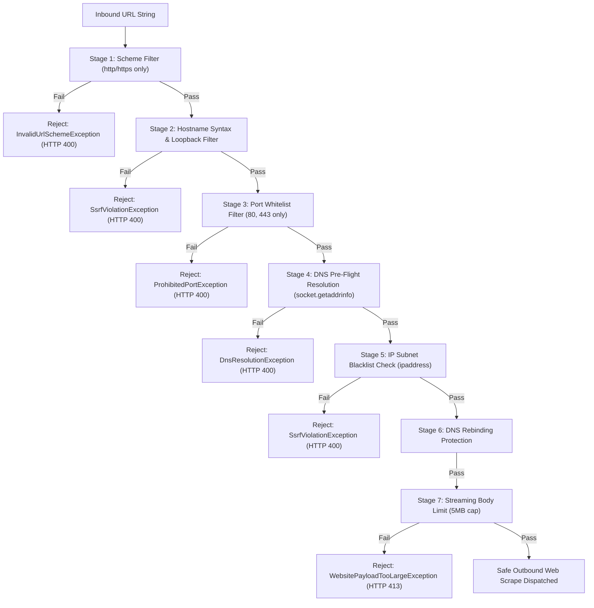

# Security Architecture: 7-Stage Zero-Trust SSRF Defense Specification

> **Author:** Piyush Makhija (Technical Lead / Senior Software Engineer)  
> **Client / Evaluator:** Dxora Technologies (`hr@chivoxai.com`)  
> **Version:** 1.0.0-PROD  
> **Date:** November 2026  

---

## 1. Zero-Trust SSRF Defense Pipeline

---

## 2. IP Subnet Blacklist Specification

The validator resolves the target domain into all associated IPv4 and IPv6 addresses and checks each address against `ipaddress.ip_network`:

| Network Range | Standard / Purpose | Threat Prevented |
|:---|:---|:---|
| `127.0.0.0/8`, `::1` | Loopback (RFC 1122) | Access to local machine services (`localhost`, 127.0.0.1). |
| `10.0.0.0/8` | Private Subnet (RFC 1918) | Access to private internal microservices and databases. |
| `172.16.0.0/12` | Private Subnet (RFC 1918) | Access to Docker internal bridge networks and VPC nodes. |
| `192.168.0.0/16` | Private Subnet (RFC 1918) | Access to LAN internal network assets. |
| `169.254.0.0/16` | Link-Local (RFC 3927) | **Critical:** Theft of cloud instance metadata (`169.254.169.254`). |
| `fe80::/10` | IPv6 Link-Local | IPv6 link-local network traversal. |
| `100.64.0.0/10` | Carrier-Grade NAT (RFC 6598) | Service provider internal infrastructure traversal. |
| `224.0.0.0/4`, `240.0.0.0/4` | Multicast & Reserved | Network broadcast and spoofing attacks. |
| `255.255.255.255/32` | Limited Broadcast | Broadcast packet amplification. |

---

## 3. Allowed Ports Whitelist
The microservice explicitly restricts outbound traffic to standard web ports:
- Port `80` (Standard HTTP)
- Port `443` (Standard HTTPS)
All non-standard ports (e.g. 21, 22, 25, 3306, 5432, 6379, 8000, 8080, 27017) are blocked immediately with `ProhibitedPortException`.
