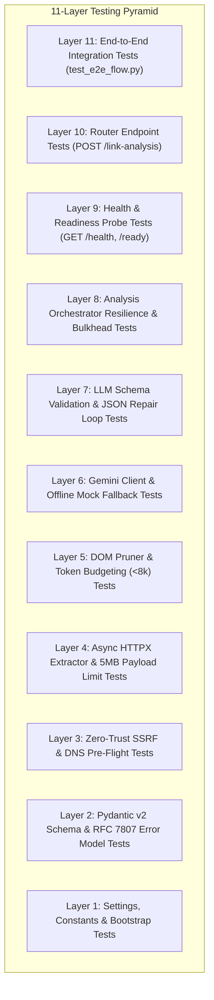

# Testing Architecture: 11-Layer Test Strategy

> **Author:** Piyush Makhija (Technical Lead / Senior Software Engineer)  
> **Client / Evaluator:** Dxora Technologies (`hr@chivoxai.com`)  
> **Version:** 1.0.0-PROD  
> **Date:** November 2026  

---

## 1. Testing Philosophy & Test Pyramid

The microservice implements a strict **11-Layer Testing Pyramid** following enterprise standards and `41-testing-standards-python-fastapi.md`. Testing is hermetic, deterministic, and executes in <5 seconds without external network dependencies.

---

## 2. Triad Testing Methodology

Every critical layer requires three distinct test dimensions:
1. **Positive Tests (Happy Path):** Valid inputs, successful extraction, schema compliance, HTTP 200 responses.
2. **Negative Tests (Error Path):** Invalid URLs, unreachable hosts, HTTP 401/403/404/500 upstream errors, AI rate-limiting (HTTP 429), malformed JSON.
3. **Edge-Case Tests (Adversarial & Boundary Path):** SSRF attacks (`169.254.169.254`, `127.0.0.1`, IPv6 loopback, internal ports), prompt injection attempts, massive 5MB+ payloads, empty HTML without body or title.

---

## 3. Coverage Gate & CI/CD Enforcement
- **Statement Coverage Threshold:** Minimum **90%** enforced by pytest-cov (`--cov-fail-under=90`).
- **Speed SLA:** Entire test suite runs in under 5.0 seconds via in-memory HTTPX `MockTransport` fixtures.
