# Testing Architecture: 11-Layer Test Strategy & Quality Gates

> **Author:** Piyush Makhija (Technical Lead / Senior Software Engineer)  
> **Client / Evaluator:** Dxora Technologies (`hr@chivoxai.com`)  
> **Repository:** [https://github.com/piyushmakhija28/ai-link-analysis](https://github.com/piyushmakhija28/ai-link-analysis)  
> **Version:** 1.0.0-PROD  
> **Date:** November 2026  
> **Status:** Baselined & Enforced  

---

## 1. Testing Philosophy & Hermetic Design

The `ai-link-analysis` microservice implements an institutional-grade, **11-Layer Testing Pyramid** governed by the following core principles:
1. **100% Hermetic Execution:** Unit and integration test suites run entirely in local memory with zero external network socket calls. Tests execute deterministically in **<5.0 seconds** without requiring live internet access or external API credits.
2. **Triad Testing Architecture:** Every functional layer is validated through three complementary test vectors:
   - **Positive Tests:** Valid inputs, compliant schemas, successful HTTP 200 responses.
   - **Negative Tests:** Invalid protocols, DNS resolution errors, HTTP 4xx/5xx upstream failures, LLM 429 rate limits, malformed schemas.
   - **Edge-Case Tests:** Adversarial SSRF payloads (`169.254.169.254`, IPv6 loopbacks, octal IPs), indirect prompt injection attacks, decompression bombs (5MB+), and redirect loops.
3. **Strict Coverage Gate:** Enforces a minimum threshold of **$\ge 90.0\%$ statement and branch test coverage** (`pytest-cov --cov-fail-under=90`).
4. **Zero Inline Comments in Tests:** Adheres strictly to Claude Global Rule 12 (Level 2.2 Docstrings-Only). Test functions use expressive naming (`test_<component>_<scenario>_<expected_outcome>`) and complete docstrings with zero inline `#` comments.

---

## 2. 11-Layer Test Pyramid Architecture

```mermaid
graph TD
    subgraph Pyramid["11-Layer Enterprise Test Pyramid"]
        L11["Layer 11: End-to-End Integration Flow (test_integration.py)"]
        L10["Layer 10: Router Controller & RFC 7807 Handlers (test_router_analysis.py)"]
        L9["Layer 9: SRE Health & Readiness Probes (test_health_probes.py)"]
        L8["Layer 8: Master Orchestrator & Bulkhead Isolation (test_analysis_orchestrator.py)"]
        L7["Layer 7: SHA-256 URL Cache & TTL Eviction (test_cache_service.py)"]
        L6["Layer 6: Google Gemini Client, Schema Steering & Circuit Breaker (test_llm_service.py)"]
        L5["Layer 5: Deterministic Offline Mock Client (test_llm_service.py)"]
        L4["Layer 4: Semantic DOM Tag Pruner & Token Budgeting (test_website_extractor.py)"]
        L3["Layer 3: Async HTTPX Extractor & 5MB Payload Limiter (test_website_extractor.py)"]
        L2["Layer 2: 7-Stage Zero-Trust SSRF & DNS Pre-Flight (test_ssrf_validator.py)"]
        L1["Layer 1: Settings, Constants & Domain Schemas (test_schemas.py)"]
    end

    L11 --> L10
    L10 --> L9
    L9 --> L8
    L8 --> L7
    L7 --> L6
    L6 --> L5
    L5 --> L4
    L4 --> L3
    L3 --> L2
    L2 --> L1
```



---

## 3. Test Execution Framework & Configuration

The test suite is managed via `pytest` configured in `pyproject.toml`:
```toml
[tool.pytest.ini_options]
asyncio_mode = "auto"
testpaths = ["tests"]
addopts = [
    "-v",
    "--strict-markers",
    "--cov=app",
    "--cov-report=term-missing",
    "--cov-report=html:coverage_html",
    "--cov-fail-under=90"
]
```

### CI/CD Stop-Condition Enforcement:
In GitHub Actions CI (`.github/workflows/ci.yml`), any pull request that drops test coverage below 90% or fails a single triad test is immediately blocked from merging.

---
*End of Testing Strategy Specification. Authored by Piyush Makhija for Dxora Technologies Evaluation.*
