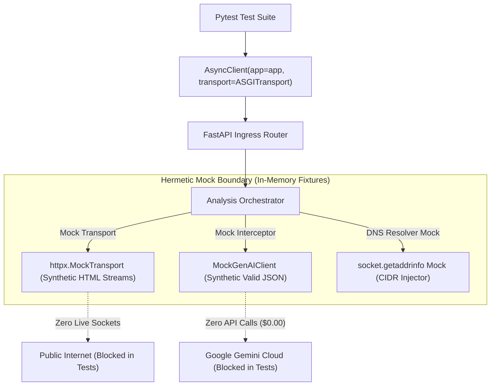

# Testing Architecture: Hermetic Mocking Strategy & Transport Interceptors

> **Author:** Piyush Makhija (Technical Lead / Senior Software Engineer)  
> **Client / Evaluator:** Dxora Technologies (`hr@chivoxai.com`)  
> **Repository:** [https://github.com/piyushmakhija28/ai-link-analysis](https://github.com/piyushmakhija28/ai-link-analysis)  
> **Version:** 1.0.0-PROD  
> **Date:** November 2026  
> **Status:** Baselined & Enforced  

---

## 1. Principles of Hermetic Testing

Unit and integration testing must be **hermetic, deterministic, and isolated**:
- Tests MUST NEVER make outbound network calls to live internet web servers or cloud LLM APIs. Live calls introduce flakiness, depend on internet availability, exhaust rate-limit quotas, and inflate API bills.
- Tests MUST NOT rely on brittle global monkey-patching (`unittest.mock.patch` of global functions).
- Instead, testing relies on **dependency injection** and official **transport-level mocking interfaces** provided by HTTPX and Google GenAI.



---

## 2. HTTPX `MockTransport` Architecture

Rather than mocking `httpx.get()` with arbitrary return objects, the test suite utilizes HTTPX's native `httpx.MockTransport` which handles full HTTP request/response lifecycles, streaming chunk iteration, and header parsing:

```python
import httpx
import pytest


def make_mock_transport(
    status_code: int = 200,
    content: bytes = b"<html><head><title>Test</title></head><body>Hello</body></html>",
    headers: dict = None,
):
    """Factory generating a deterministic in-memory HTTPX MockTransport."""

    def handler(request: httpx.Request) -> httpx.Response:
        return httpx.Response(
            status_code=status_code,
            content=content,
            headers=headers or {"Content-Type": "text/html; charset=utf-8"},
        )

    return httpx.MockTransport(handler)
```

### Simulating Streaming Chunk Limits (>5MB):
```python
def make_5mb_overflow_transport():
    """Generates an infinite chunk generator that streams beyond 5,242,880 bytes."""

    def chunk_stream():
        chunk = b"X" * 65536  # 64KB chunk
        for _ in range(100):  # Total ~6.5MB
            yield chunk

    def handler(request: httpx.Request) -> httpx.Response:
        return httpx.Response(
            status_code=200,
            content=chunk_stream(),
            headers={"Content-Type": "text/html"},
        )

    return httpx.MockTransport(handler)
```

---

## 3. Google GenAI SDK & LLM Interceptors

For LLM testing, a custom `MockGenAIClient` generates high-fidelity Pydantic-compliant responses without network overhead:
```python
class MockGenAIClient(BaseLLMClient):
    """Deterministic LLM mock client returning valid LinkAnalysisPayload."""

    def __init__(self, should_fail: bool = False, is_rate_limited: bool = False):
        self.should_fail = should_fail
        self.is_rate_limited = is_rate_limited

    async def analyze(
        self, document: PrunedDocument, correlation_id: str
    ) -> LinkAnalysisPayload:
        if self.is_rate_limited:
            raise UpstreamRateLimitError("429 Resource Exhausted")
        if self.should_fail:
            raise LLMSynthesisError("Simulated LLM synthesis failure")

        return create_synthetic_payload(document.target_url)

    def get_provider_name(self) -> str:
        return "mock-testing-provider"
```

---
*End of Mocking Strategy Specification. Authored by Piyush Makhija for Dxora Technologies Evaluation.*
